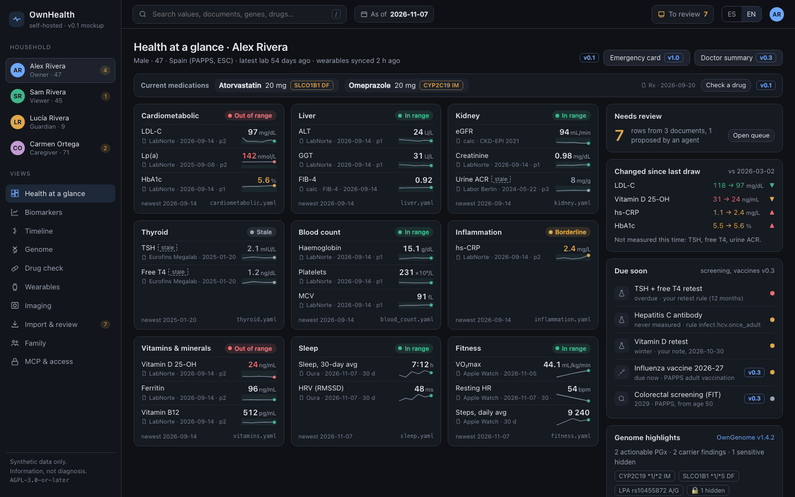

<h1 align="center">OwnHealth</h1>

  

OwnHealth is a self-hosted personal health record with an MCP server. It keeps your lab results, medical records from any country, wearable data, genome findings and imaging in one place you run yourself, and lets an agent such as Claude Code answer "how is my health right now?" from it.

OwnHealth is a common-good project: no hosted or paid version, ever. You run it yourself.

  

**Status: pre-alpha.** There is no code yet. The plan, the roadmap and a static mockup with synthetic data are in `docs/`.

## Features

Planned, not built yet:

- One dashboard for the whole family, one profile per person
- Lab reports read from PDFs and photos into trendable values, each linked to its source page
- Records from any country: lab PDFs, FHIR and IPS bundles, the Apple Health export; US patient portals later, and a connector SDK for the rest
- Wearables: Apple Health, Health Connect, Garmin, Oura, Whoop, Withings and more
- Genome findings from [OwnGenome](https://github.com/GeiserX/OwnGenome), such as drug response, carrier status and risk variants, joined with medications and labs
- Imaging studies (MRI, CT, X-ray) through a DICOM viewer
- An MCP server scoped per person, with a citation behind every answer

## Quick start

Not runnable yet. Watch the repo for the first release.

## Documentation

- [Plan](docs/PLAN.md): the problem, principles, decisions and MCP examples
- [Roadmap](docs/ROADMAP.md): phases, deliverables and exit criteria
- [Mockup](docs/mockup/README.md): the web page with synthetic data, with screenshots
- Design: [architecture](docs/design/architecture.md), [ingestion](docs/design/ingestion.md), [connectors](docs/design/connectors.md), [MCP](docs/design/mcp.md), [genomics](docs/design/genomics.md), [security and privacy](docs/design/security-privacy.md)
- [Rivals](docs/research/rivals.md)
- [Security policy](SECURITY.md)

## Related projects

[OwnGenome](https://github.com/GeiserX/OwnGenome) produces the genome findings OwnHealth shows. It turns a whole genome or a consumer chip into drug-response, carrier and risk findings; OwnHealth ingests them and joins them with your medications and labs.

## License

[AGPL-3.0-or-later](LICENSE)
