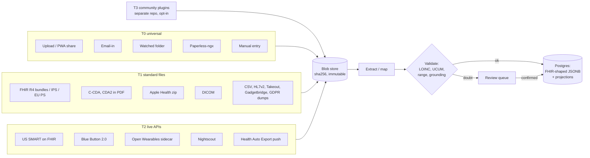
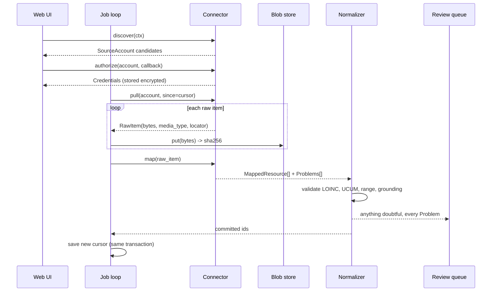

# Connectors: where the data comes from

Status: design, 2026-11-07. Phases (v0.1, v0.2, v0.3, v1.0, v2) are the ones in the roadmap. Anything marked (unverified) needs a check against the primary source before a connector depends on it.

## 1. The rule

Outside the US, almost no country lets one person register an app against a patient API. Spain, Italy, Germany, the Nordics, Brazil and most of Latin America and Asia hand the patient PDFs in a portal behind national eID. Private hospitals and labs everywhere hand out PDFs, often by email. So the order is fixed:

1. **Universal importers first** (T0). PDF, photo, email, folder and manual entry work in every country.
2. **Standard file importers next** (T1). They are files, not integrations: nobody has to approve us.
3. **Live APIs only where a self-hoster can register alone** (T2). That is mostly the US and a handful of wearable vendors.
4. **Browser-session plugins** (T3) live in a separate community repo, opt-in, labelled "may break".
5. **Never** build what needs a company, a certification or a national approval (T4). Import the files that certified apps export instead.

Every connector writes the original artifact to the blob store before it parses anything, and every value it produces points back to that artifact. That is principle 1 (provenance) and principle 2 (nothing silent) applied to ingestion.



## 2. Tier model

| Tier | What it is | Who has to register | Breaks when | Ships in |
|---|---|---|---|---|
| T0 | Universal: PDF (text layer), photo/scan (OCR), email-in, watched folder, Paperless-ngx, PWA share target, manual entry | Nobody | Never on the vendor side; extraction quality varies | Core repo |
| T1 | Standard files: FHIR R4 bundles, SMART Health Cards/Links, C-CDA, CDA2, HL7 v2 ORU, CSV, DICOM, Apple Health zip, Google Takeout, Gadgetbridge DB, vendor GDPR exports | Nobody | A vendor changes its export layout (lenient parsers, versioned) | Core repo |
| T2 | Live APIs one self-hoster can register for | The self-hoster, per instance (US SMART: bring-your-own client wizard, section 7) | Vendor API changes, token rotation bugs, ToS changes | Core repo or the `wearables` profile |
| T3 | Browser-session plugins: the user logs in with their own eID in a real browser; the plugin reuses the session to list and fetch documents | Nobody, but ToS may forbid automation | Every portal redesign | Separate community repo, opt-in, v2 |
| T4 | APIs that need a legal entity, a certification or a national approval | A company | n/a | Not built. Import what certified apps export |

### 2.1 T0: universal

| Connector | Mechanism | Phase | Notes |
|---|---|---|---|
| Upload | Drag and drop, multi-file, in the web UI | v0.1 | Same queue as every inbox |
| PDF lab import (text layer) | pdfplumber / pypdfium2, vendor table rules plus a generic table rule | v0.1 | Born-digital PDFs never go through OCR |
| Manual entry | Form per kind (observation, medication, condition, vaccine) | v0.1 | A correction is a new version, never an overwrite |
| Email-in | IMAP poll of a dedicated mailbox; sender allowlist; from-address picks the profile; per-sender PDF password rule held in the secrets store, never logged | v0.2 | The main channel for private labs in Spain and Latin America. Non-allowlisted mail goes to quarantine |
| Watched folder | `/inbox/<profile>/`, polling; move to `.done` only after the blob is committed | v0.2 | Scanner target over SMB/FTP, synced phone folder |
| Paperless-ngx | Workflow "Document Added" + webhook to `/api/ingest/paperless`, then pull the original with `/api/documents/<id>/download/?original=true`; polling fallback by tag and `modified__gt` | v0.2 | Paperless already OCRs to PDF/A; our text-first path reads that layer |
| PWA share target | `share_target` in the manifest (Android); iOS Shortcut POSTing to a per-device upload token URL | v0.2 | iOS Safari has no share_target |
| Photo / scan OCR | `ocr` compose profile: PaddleOCR PP-StructureV3 or Docling on CPU, PaddleOCR-VL 0.9B on GPU/iGPU | v0.2 | Deskew and dewarp before OCR |
| Agent-assisted extraction | Outside agent reads pending pages over MCP (`list_pending_documents`, `get_document_page`) and calls `propose` | v0.2 | Proposals are validated and queued, never written directly |

Email-in and the watched folder carry the highest prompt-injection exposure: anyone who knows the address can send a PDF. Sender allowlist, quarantine, and `trust: untrusted_text` on every free-text field returned over MCP are mandatory, not options.

### 2.2 T1: standard files

| Format | Where it comes from | Parser | Phase |
|---|---|---|---|
| FHIR R4 Bundle (any IG: US Core, IPS, AU Core, NRCeS India, MedMij zibs) | US portals, IAS apps, Fasten/yourphr exports, other PHRs | Our own mapper to the internal store; raw resource kept | v0.1 |
| IPS (`Bundle.type = document` + `Composition`) | Cross-border summaries, some national portals | Same as above, with Composition sections mapped | v0.1 |
| EU Patient Summary, HL7 Europe Laboratory Report | EHDS (2029 / 2031), MyHealth@EU | Profile-aware mapping (lab result grouping, specimen, EU value sets) | Readable as generic FHIR in v0.1; profile-specific mapping v2 |
| Apple Health export zip | iPhone: Health → profile → Export All Health Data | Stream `export.xml` with `iterparse`; `clinical-records/*.json` as FHIR R4; ECG CSVs; workout GPX | v0.1 |
| SMART Health Cards (JWS in QR) / SMART Health Links (encrypted manifest) | Vaccine and lab certificates, US "Kill the Clipboard" QR flows, IAS apps | Verify JWS, decrypt JWE with the key from the URL fragment, fetch manifest, import FHIR | Receive: v1.0. Share from the UI: v1.0, ciphertext on a host the user controls; we run no share host |
| C-CDA (CCD) | US portal "download my record", Australian MHR documents | CDA → FHIR mapper (candidate: Microsoft FHIR-Converter, MIT) (unverified fit) | v1.0 |
| CDA2 inside a PAdES-signed PDF | Italy FSE 2.0 | Extract the embedded XML attachment before any OCR; structured labs with LOINC | v2 |
| HL7 v2 ORU^R01 | Some LIS exports and lab portals | `python-hl7`-style segment parser, OBX → Observation | v2 |
| CSV with column mapper | Lab portals, spreadsheets people already keep, vendor CSV exports | Saved mapping per source (column → LOINC, unit, date format) | v2 (with the HL7 v2 importer) |
| DICOM (CD, zip, folder) | Hospital CDs, private imaging portals | Pushed to Orthanc (`imaging` profile); report text linked to the study | v1.0 |
| Google Takeout (Fitbit) | takeout.google.com | Lenient per-metric JSON/CSV parser; layout changes over time | v1.0 |
| Garmin "Export Your Data" | Garmin account GDPR export: FIT + JSON | FIT via `fitdecode` | v1.0 |
| Gadgetbridge SQLite | Android app, fully offline, no vendor cloud | Read device tables by device type | v0.2 |
| Vendor GDPR exports (Clue JSON, Flo, Natural Cycles, Samsung Health CSV, Huawei, Withings CSV, Polar Flow, Dexcom Clarity CSV, LibreView CSV) | Account settings or a GDPR Art. 15/20 request | One small parser each, registered as a T1 connector | LibreView and Dexcom Clarity CSV v1.0; cycle, nutrition and training exports v2; the rest not scheduled |
| Taiwan My Health Bank (HTML/XML/JSON) | NHI portal download | JSON parser | v2 |
| Consumer genome files, VCF | 23andMe, MyHeritage, Ancestry, WGS | Not a connector here: OwnGenome ingests them and emits `genome-facts.json` | v0.1 (facts ingest) |

### 2.3 T2: live APIs a self-hoster can register for

| API | Client type | Registration | Data | Phase |
|---|---|---|---|---|
| US SMART on FHIR patient standalone launch (Epic, Oracle Health, athenahealth, eClinicalWorks, MEDITECH, NextGen, Veradigm, VA Lighthouse) | Public (PKCE) or confidential (JWT client assertion) | Bring-your-own client per vendor (section 7); a shared project client is an open decision | US Core / USCDI: labs, vitals, meds, conditions, allergies, immunizations, notes, documents | v1.0 |
| CMS Blue Button 2.0 | Confidential, authorization code only | BYO; sandbox self-serve, production needs CMS approval (unverified effort) | Medicare A/B/D claims as CARIN BB `ExplanationOfBenefit`, `Coverage`, `Patient` | v1.0 |
| US payer Patient Access APIs (CMS-9115-F) | Per payer | BYO per payer (unverified how many accept self-registration) | CARIN BB claims + US Core clinical | After v1.0, per payer (not scheduled) |
| Oura v2 | OAuth only (PATs gone since Dec 2025); single-use refresh tokens | BYO app, 10 users before approval | Sleep, readiness, HRV, temperature deviation, SpO2 | v1.0 via `wearables` |
| Whoop v2 | OAuth | BYO app, self-serve | Recovery, HRV, RHR, strain, sleep, SpO2, skin temperature | v1.0 via `wearables` |
| Polar AccessLink v3 | OAuth; must register the user after OAuth | BYO app, free, no approval | Nightly Recharge, sleep, 24/7 HR; only about 30 to 90 days back, so poll from day one | v1.0 via `wearables` |
| Withings Public API | OAuth | BYO app, free | Weight and body composition, BP, ECG, sleep, temperature, SpO2 | v1.0 via `wearables` |
| Dexcom API v3 | OAuth | BYO app; Sandbox → Limited (5 users) | EGV every 5 min, delayed 1 h (US) / 3 h (elsewhere); 90 days back | v1.0 |
| Nightscout | Read token over REST (`/api/v1/entries/sgv.json`, v3 API) | The user's own Nightscout | CGM, treatments, device status | v0.2 |
| Health Auto Export (iOS, paid) | Push: the app POSTs JSON v2 to our REST endpoint on a schedule | A per-device ingest token from our UI | Everything in HealthKit except clinical records | v0.2 |
| Hevy | API key, Pro only | Key from the user's settings | Workouts, sets, body measurements | v2 (training lane) |
| wger | REST token on the user's own instance | Their instance | Workouts, nutrition, weight | Not scheduled |

All wearable OAuth (Oura, Whoop, Polar, Withings, and Garmin/Suunto for anyone holding partner approval) goes through the Open Wearables sidecar in the `wearables` profile. We do not reimplement those OAuth flows. OwnHealth has one connector, `openwearables`, that pulls normalized samples and daily summaries from the sidecar's REST API. Coros is not an Open Wearables provider; it stays FIT export only. Open Wearables also ships a Strava API provider. We disable it in the sidecar config, and the `openwearables` connector drops any sample whose provider is `strava`, so no Strava API data reaches the store or MCP (section 4). Dexcom is not in Open Wearables' provider list (unverified as of today), so Dexcom is a native T2 connector, or users route it through Nightscout.

We never ship a client secret in the repo. Every T2 connector needs the self-hoster to register their own app. Each connector has a setup page that shows the exact redirect URI, the scopes to tick and the vendor's registration URL.

### 2.4 T3: browser-session plugins (separate repo, v2)

The user logs in to a portal with their own eID (Cl@ve, MitID, BankID, SPID) in a real browser on their own machine. The plugin reuses that session to list documents and download them, or calls the portal's internal JSON endpoints (the dhroxy pattern for sundhed.dk). Rules:

- Lives in a separate repo (`OwnHealth-plugins`, name proposed), never in core. Core never installs a plugin by itself.
- Never stores eID credentials or certificates. A manual 2FA step each session is expected.
- Output is files (PDF, CDA, JSON) dropped into the same intake as an upload, so all extraction, validation and review stays in core.
- Each plugin declares in its manifest: portals it touches, hosts it calls, whether it needs a browser, ToS status per portal, maintainer.
- First candidates: HCDSNS via Cl@ve, Madrid Mi Carpeta de Salud, La Meva Salut, Quirónsalud, sundhed.dk (dhroxy), 1177, Helsenorge, NHS App web, Meu SUS Digital.

### 2.5 T4: needs a legal entity (not built)

France Mon espace santé referenced apps (GIE SESAM-Vitale, HDS hosting), Netherlands MedMij PGO certification (NEN 7510 / ISO 27001), Australia My Health Record FHIR Gateway (consumer model #4, registered organisation), India ABDM HIU/PHR certification (CERT-In audit), Japan Mynaportal API (ISMS or Privacy Mark), Taiwan My Health Bank SDK, UK IM1 Patient and GP Connect Patient Facing (DTAC, DCB0129), Germany ePA third-party access (DiGA only), Korea MyHealthway transfer to private apps (restricted by law), US TEFCA Individual Access Services (IAL2, QHIN sponsor), Garmin/Suunto/Coros/Ultrahuman/Samsung partner programs.

What we do instead: import the file the certified app or portal lets the person download (FHIR bundle, CDA, PDF), and use the phone hubs for devices. We revisit EU entries when EHDS forces downloads in the exchange format (section 8).

## 3. Country matrix

Legend. API = a patient-facing API a third-party app can use. Tier = how OwnHealth gets the data. Phase = when that path ships. Almost every row also has the T0 PDF path from v0.1, and email-in from v0.2; the Phase column names the best path, not the first.

### 3.1 United States

| System | Patient-facing API? | Downloadable format | Auth hurdle | Our tier | Phase |
|---|---|---|---|---|---|
| Epic (MyChart) | Yes, SMART on FHIR R4 (US Core) | FHIR via API; CCD and PDF from MyChart; Epic EHI export | MyChart login; app client auto-distributed if read-only, patient-facing, USCDI scopes only | T2 (T1 for CCD/EHI) | v1.0 |
| Oracle Health (Cerner Millennium) | Yes, SMART on FHIR R4 | FHIR; CCD; PDF | Portal login; client via code.cerner.com (unverified current flow) | T2 | v1.0 |
| athenahealth | Yes, SMART on FHIR R4 | FHIR; CCD; PDF | Portal login; per-vendor registration (unverified review step) | T2 | v1.0 |
| eClinicalWorks / healow, MEDITECH Expanse, NextGen, Veradigm | Yes, certified (g)(10) APIs | FHIR; CCD; PDF | Per-vendor registration | T2 | v1.0 |
| VA (My HealtheVet) | Yes, VA Lighthouse Patient Health API (FHIR R4) | FHIR; Blue Button text/PDF | Login.gov / ID.me; production needs VA review (unverified effort) | T2 | v1.0 |
| CMS Medicare | Yes, Blue Button 2.0 (claims) | FHIR (CARIN BB) | Medicare.gov login; confidential client; CMS production approval | T2 | v1.0 |
| Private payers (MA, Medicaid, ACA plans) | Yes, Patient Access APIs | FHIR (CARIN BB + US Core) | Per payer | T2 | v2 |
| Quest, Labcorp | No public patient API (unverified) | PDF; results also reach the ordering provider's FHIR API | Portal login | T0, or via provider SMART | v0.1 / v1.0 |
| TEFCA IAS apps | Not for us (IAS provider needs IAL2 + QHIN) | FHIR bundle or SHL if the IAS app exports one | IAS app identity proofing | T1 (import their export) | v0.1 (bundle) |
| Apple Health Records (US, CA, UK) | On-device only | `clinical-records/*.json` FHIR inside the export zip | iPhone | T1 | v0.1 |

### 3.2 Spain

| System | Patient-facing API? | Downloadable format | Auth hurdle | Our tier | Phase |
|---|---|---|---|---|---|
| HCDSNS (national, Ministry and each CCAA mirror; also Carpeta Ciudadana) | No | PDF: Historia Clínica Resumida, discharge, outpatient, emergency, nursing, labs, imaging reports, EU Patient Summary (PDF). CDA to the patient: unverified | DNIe, FNMT certificate, Cl@ve PIN / Permanente | T0; T3 plugin | v0.1; v2 |
| Madrid: Tarjeta Sanitaria Virtual → Mi Carpeta de Salud | No | PDF per report: labs, imaging, discharge, nursing | Cl@ve, certificate, DNIe | T0; T3 | v0.1; v2 |
| Catalunya: La Meva Salut | No | PDF per report; EU patient summary with certificate login | Certificate, idCAT Mòbil, CIP + password | T0; T3 | v0.1; v2 |
| Andalucía: ClicSalud+ / app Salud Andalucía | No (unverified) | PDF reports, labs, vaccines | Cl@ve, certificate | T0; T3 | v0.1; v2 |
| Comunitat Valenciana: GVA+Salut, HSE | No | PDF | Cl@ve/certificate, SIP card, residency | T0; T3 | v0.1; v2 |
| Euskadi: Osakidetza app / Carpeta de Salud | No (unverified) | PDF | BakQ, certificate (unverified) | T0; T3 | v0.1; v2 |
| Galicia: E-Saúde | No (unverified) | PDF | Cl@ve, certificate (unverified) | T0; T3 | v0.1; v2 |
| Illes Balears: EspaiSalut | No | PDF | Cl@ve, certificate | T0; T3 | v0.1; v2 |
| Asturias (Mi AsturSalud), Aragón (Salud Informa), Castilla y León, Castilla-La Mancha, Canarias, Navarra (Carpeta Personal de Salud), Murcia, Extremadura, Cantabria, La Rioja | No (unverified per region) | PDF | Cl@ve, certificate, regional PIN | T0; T3 | v0.1; v2 |
| Quirónsalud (Mi Quirónsalud) | No | PDF per report; DICOM images from the web portal only | Portal login | T0; T1 DICOM; T3 | v0.1; v1.0; v2 |
| Sanitas (Mi Sanitas, Blua) | No | PDF | App login | T0; T3 | v0.1; v2 |
| HM Hospitales, Vithas, Adeslas, Asisa, DKV | No (unverified) | PDF where the insurer owns the clinic | App login | T0 | v0.1 |
| Labs: Synlab, Eurofins Megalab, Unilabs | No | PDF, often by email, often password-locked with the DNI | Lab-issued login or email | T0 (email-in with per-sender password) | v0.2 |
| Any provider: GDPR Art. 15 / 20 request | n/a | PDF, paper, CD with DICOM | Written request | T0 / T1 | v0.1 |

### 3.3 Rest of Europe

| Country / system | Patient-facing API? | Downloadable format | Auth hurdle | Our tier | Phase |
|---|---|---|---|---|---|
| France: Mon espace santé (DMP) | Only for state-referenced apps | PDF, CDA from the DMP | FranceConnect; referencing needs a company and HDS hosting | T0 (T4 API not built) | v0.1 |
| Germany: ePA für alle (insurer apps) | No (DiGA only) | PDF/documents in the app; medication list | GesundheitsID, eGK + PIN | T0 | v0.1 |
| Italy: FSE 2.0 (regional) | No | PAdES-signed PDF with embedded CDA2 | SPID, CIE | T1 (CDA2 from PDF), T0 fallback | v2; v0.1 |
| Portugal: SNS 24, RSE | No (unverified) | PDF, labs, vaccines | Chave Móvel Digital, Cartão de Cidadão | T0 | v0.1 |
| Netherlands: MedMij into a certified PGO | Only certified PGOs | FHIR (zibs) inside the PGO; export to the user unverified | DigiD | T1 if a PGO exports; else T0 | v0.1 |
| Belgium: Mijngezondheid / Masanté, hubs | No (unverified) | PDF, vaccination, medication schema | itsme, eID | T0 | v0.1 |
| Sweden: 1177 Journalen | No (unverified) | View; print to PDF | BankID | T0; T3 | v0.1; v2 |
| Norway: Helsenorge | Early open FHIR R4 profiles, "breaking changes may occur"; third-party patient access unverified | Documents, test results, vaccines | BankID, ID-porten | T0; T3 | v0.1; v2 |
| Finland: OmaKanta | Kanta PHR API is for self-entered wellbeing data only, development paused | View, print | Suomi.fi | T0 | v0.1 |
| Denmark: sundhed.dk, MinSundhed | No official API; dhroxy reuses the browser session | Labs, diagnoses, medication card | MitID | T3 (dhroxy pattern) | v2 |
| Estonia: digilugu.ee | No (unverified) | Summaries, prescriptions, PDF | ID-card, Mobiil-ID, Smart-ID | T0 | v0.1 |
| UK: NHS App | IM1 / GP Connect PFS for assured suppliers only | Screens, some letters; no coded-record download (unverified) | NHS login | T0; Apple Health Records for a few trusts (T1) | v0.1 |
| Ireland: HSE Health App | No | Very little; GDPR request | MyGovID | T0 | v0.1 |
| Switzerland: EPD (E-GD rewrite not before 2030) | No | PDF | Swiss eID / provider login | T0 | v0.1 |

### 3.4 Americas, Asia-Pacific, Middle East, Africa

| Country / system | Patient-facing API? | Downloadable format | Auth hurdle | Our tier | Phase |
|---|---|---|---|---|---|
| Canada: provincial portals; Epic/Cerner hospitals | Yes at Epic and Cerner sites (SMART) | FHIR via SMART; PDF; Apple Health Records | Portal login | T2 at Epic/Cerner; T0 | v1.0; v0.1 |
| Australia: My Health Record | Gateway for registered organisations only | PDF / CDA via myGov (unverified) | myGov | T1 (CDA), T0 | v1.0; v0.1 |
| New Zealand: Manage My Health, MyIndici, ConnectMe | No (unverified) | PDF | Portal login | T0 | v0.1 |
| India: ABDM (ABHA app, DigiLocker) | HIU/PHR apps need certification | PDF; FHIR bundle download unverified | ABHA | T1 if FHIR export exists; T0 | v0.1 |
| Singapore: HealthHub | No (unverified) | Lab results, immunisations, visit summaries (view, PDF) | Singpass | T0 | v0.1 |
| Japan: Mynaportal | API for certified PHR companies only | PDF; CSV-like download unverified | My Number Card | T0 | v0.1 |
| Korea: MyHealthway → 나의건강기록 app | Transfer to private apps restricted by law | App view; export unverified | Government ID | T0 | v0.1 |
| Taiwan: My Health Bank | SDK for registered apps (T4) | HTML, XML, JSON download by the user | NHI card / mobile ID | T1 (JSON) | v2 |
| China: hospital WeChat mini-programs, provincial health cards | No national API (unverified) | PDF, images | WeChat / hospital account | T0 (photo OCR) | v0.2 |
| Israel: HMO apps (Clalit, Maccabi, Meuhedet, Leumit) | No public patient API (unverified) | PDF, lab results in app | HMO login | T0 | v0.1 |
| UAE: Malaffi (Abu Dhabi), NABIDH (Dubai), EHS app | No (unverified) | PDF | UAE Pass | T0 | v0.1 |
| Brazil: Meu SUS Digital (RNDS) | RNDS FHIR R4 for authorized systems only | App view; PDF | gov.br | T0; T3 | v0.1; v2 |
| Brazil private labs (Fleury, Dasa, Hermes Pardini) | No (unverified) | PDF | Portal login, email | T0 | v0.1 |
| Mexico: IMSS Digital, ISSSTE; labs (Chopo, Salud Digna) | No (unverified) | PDF, emailed PDF | Portal or email | T0 (email-in) | v0.2 |
| Argentina: Mi Argentina, provincial systems | No (unverified) | Vaccines, some records | Mi Argentina | T0 | v0.1 |
| Chile: Fonasa, Mi Salud; private networks | No (unverified) | PDF | ClaveÚnica | T0 | v0.1 |
| Colombia: IHCE (FHIR between institutions) | No patient API (unverified) | PDF (e.g. lab portals) | Portal login | T0 | v0.1 |
| South Africa: private hospital groups, labs (Lancet, PathCare, Ampath) | No (unverified) | PDF, emailed PDF | Portal or email | T0 (email-in) | v0.2 |

The legal fallback in every GDPR, LGPD or HIPAA jurisdiction is an access request (GDPR Art. 15, portability Art. 20, LGPD Art. 18, HIPAA right of access). Answers come as PDF, paper or a CD with DICOM, which all land in T0 or T1.

## 4. Wearables, devices and apps

Most devices write to Apple HealthKit or Android Health Connect. Neither hub has a cloud API, so one hub path covers most devices: the Apple Health zip (v0.1), Health Auto Export push (v0.2), and a companion app for Health Connect (v2). Direct vendor APIs are only worth it where the vendor lets one person register, or where the vendor holds data the hub does not.

ToS/AI risk means: does the vendor's API agreement restrict feeding the data to an AI model or exposing it through an MCP server? Our main use case is exactly that. File exports of the user's own data are the user's files; API terms do not reach them (our reading, not legal advice).

| Source | Access path we use | Registration needed | ToS / AI-use risk | Phase |
|---|---|---|---|---|
| Apple Health | Export zip (T1); Health Auto Export push (T2); own iOS app later | None; Health Auto Export is a paid app | None for the export | v0.1 zip; v0.2 push; v2 app |
| Android Health Connect | Companion app (ours or Open Wearables' Kotlin SDK); medical records API is experimental (Android 16) | Play policy for medical records unset | Low | v2 |
| Samsung Health | Through Health Connect; in-app personal data CSV export (unverified current) | Data SDK needs partner approval (T4) | Low via hubs | v2 (Health Connect companion); CSV not scheduled |
| Fitbit / Google | Google Takeout (T1) + Health Connect. Fitbit Web API shut down autumn 2026; Google Health API v4 not onboarding new projects (unverified today) | None for Takeout | Low for Takeout | v1.0 |
| Garmin | GDPR "Export Your Data" FIT + JSON (T1); Apple Health / Health Connect. Health API is business-only. Unofficial `python-garminconnect` not in core | None for export | High for scraping; reportedly allows AI processing with disclosure (unverified) | v1.0 |
| Oura | v2 OAuth via Open Wearables (T2); in-app CSV/JSON | BYO OAuth app (10 users before approval) | Medium: an "API and MCP Agreement" from 2026-06-08 reportedly restricts AI processing (unverified). Read before shipping | v1.0 |
| Whoop | v2 OAuth via Open Wearables | BYO OAuth app | Low (unverified) | v1.0 |
| Polar | AccessLink v3 via Open Wearables; poll, history is short | BYO app | Low | v1.0 |
| Withings | Public API via Open Wearables; CSV export | BYO app; Withings+ subscription for accounts after 2026-10-11 (unverified) | Low | v1.0 |
| Coros | FIT export; Apple Health / Health Connect | Partner API by application (T4) | Medium | v1.0 (FIT via Garmin FIT parser) |
| Suunto | FIT export; hubs | API Zone companies only (T4) | Medium | v1.0 (FIT) |
| Amazfit / Zepp | Gadgetbridge (offline, T1); Zepp → hubs | None for Gadgetbridge | None for Gadgetbridge | v0.2 |
| Huawei | GDPR export; Gadgetbridge for many bands; limited hub sync (unverified) | Health Kit enterprise approval (T4) | Medium | v0.2 (Gadgetbridge); cloud export not planned |
| Xiaomi / Mi Fitness | Gadgetbridge; Mi Fitness → hubs (unverified per type) | None | None for Gadgetbridge | v0.2 |
| Gadgetbridge | SQLite export file (T1) | None | None (AGPL app, local data) | v0.2 |
| Strava | **Bulk account export only** (zip of FIT/GPX + CSV). **No API connector, ever**: the June 2026 API Policy §5.3 bans ingestion into a context window and §5.16 bans running an MCP server over Strava API data, even with athlete consent | None for the export | Very high for the API | v1.0 (export, FIT/GPX) |
| Eight Sleep | Apple Health / Health Connect only. No public API; private-API libraries not in core | None | High for private API | via hubs |
| Ultrahuman | Hubs; UltraSignal partner API needs approval (T4) | Partner | Medium | via hubs |
| Dexcom | API v3 native (T2); Clarity CSV (T1); Nightscout | BYO app; Limited tier 5 users | Medium for Share API (not used) | v1.0 API; v0.2 via Nightscout |
| FreeStyle Libre | Nightscout with `nightscout-connect` (LibreLinkUp); LibreView CSV | User's Nightscout | Medium (LibreLinkUp is unofficial) | v0.2 |
| Nightscout | REST with read token (T2) | Own instance | None | v0.2 |
| Omron | Hubs; in-app CSV | None | Low | v0.1 (zip); CSV not scheduled |
| Renpho | Hubs; CSV | None | Medium for private API (not used) | via hubs |
| Kardia (AliveCor) | PDF per ECG via email-in or upload; store PDF + device rhythm label only | None | Low | v0.2 |
| Cronometer | CSV export (servings, daily nutrition, biometrics); hubs | None | Low | v2 (nutrition lane) |
| MyFitnessPal | CSV export (Premium); hubs. API closed to new developers (unverified) | None | Low | v2 (nutrition lane) |
| MacroFactor | In-app export (format unverified); hubs | None | Low | v2 (nutrition lane) |
| Hevy | API key (Pro) or CSV | Pro subscription | Low; API "may change or be abandoned" | v2 (training lane) |
| Strong | CSV export | None | Low | v2 (training lane) |
| wger | REST token on own instance | Own instance | None | Not scheduled |
| Clue | GDPR JSON export; hubs | None | Low; data is `read:sensitive` | v2 (cycle lane) |
| Flo | GDPR export by request; hubs | None | Low; `read:sensitive` | v2 (cycle lane) |
| Natural Cycles | Export; writes cycle/BBT to hubs | None | Low; `read:sensitive` | v2 (cycle lane) |
| Bearable | CSV export | None | Low; mood/symptoms are `read:sensitive` | v2 |
| Daylio | CSV or `.daylio` backup | None | Low; `read:sensitive` | v2 |

Rules that apply to every device source:

- **Source priority per profile per metric** (for example sleep: Oura > Watch > phone) applies at query time, never at ingest. All raw samples are kept. The same Withings weight arrives directly, through Apple Health and through Health Auto Export; external IDs plus priority stop double counting.
- **Vendor scores are not measurements.** Readiness, recovery, Body Battery and strain go in with `computed_by: provider` and a local code system, never next to LOINC vitals.
- **HRV is never compared across vendors.** The method (rMSSD at night, SDNN spot reading) is stored with every value.
- **Short-window APIs are polled from day one** (Polar about 30 to 90 days, Dexcom 90 days) and a sync gap raises a visible warning.
- **Single-use refresh tokens** (Oura, Whoop, Dexcom): persist the new token in the same transaction that marks the old one used, before the next request.
- Store UTC plus the original offset; assign a sleep to the date of waking.
- Cycle, mental-health and sexual-health data carry scope `read:sensitive` from the first row.

## 5. Phase summary

| Phase | Connectors |
|---|---|
| v0.1 | Upload, PDF text-layer lab import, manual entry (including current medications, which feed `check_drug` with PGx and labs), Apple Health zip (incl. `clinical-records/` FHIR), FHIR R4 / IPS bundle import (EU PS read as generic FHIR), OwnGenome facts + VCF |
| v0.2 | Email-in, watched folder, Paperless-ngx, PWA share target, `ocr` profile, agent-assisted extraction, Health Auto Export push, Gadgetbridge DB, Nightscout (incl. Libre via nightscout-connect) |
| v0.3 | No new sources; the full medication and supplement lane widens what `check_drug` sees; chip input via OwnGenome |
| v1.0 | US SMART on FHIR, Blue Button 2.0, `wearables` profile (Open Wearables: Oura, Whoop v2, Polar, Withings; its Strava provider disabled), Dexcom v3, Garmin export, Google Takeout, Strava bulk export, Coros and Suunto FIT, LibreView and Dexcom Clarity CSV, `imaging` profile (DICOM into Orthanc), SMART Health Cards/Links receive, C-CDA |
| v2 | EU Patient Summary and HL7 Europe Lab profile mapping, Italy CDA2-in-PDF, HL7 v2 and lab CSV with column mapper, Taiwan My Health Bank, connector SDK published, community plugins repo (T3), companion app (Health Connect incl. medical records, HealthKit), Samsung Health via Health Connect, cycle, nutrition and training lanes, access-request letter generator. Payer APIs come after v1.0, per payer, not yet scheduled |

## 6. Connector SDK

One interface for every tier. Core connectors and community plugins implement the same protocol. Plugins register through the Python entry point group `ownhealth.connectors`. The SDK is internal from v0.1 (every importer above uses it) and published as a stable API in v2.

### 6.1 Lifecycle



`pull` and `map` are separate on purpose. `pull` touches the network and stores bytes; `map` is a pure function of the stored bytes and the parser version. When a parser improves, a job re-runs `map` over stored blobs with no new network call. That is how "derived values are recomputable" holds for connectors.

### 6.2 Interface sketch

```python
from __future__ import annotations
from dataclasses import dataclass, field
from datetime import datetime
from enum import Enum
from typing import AsyncIterator, Iterable, Protocol, Literal, Any

class Tier(str, Enum):
    T0 = "universal"
    T1 = "standard_file"
    T2 = "live_api"
    T3 = "browser_session"       # T4 (legal-entity APIs) is never implemented

@dataclass(frozen=True)
class ConnectorManifest:
    id: str                       # "us-smart", "apple-health-zip", "es-hcdsns" (plugin)
    version: str                  # parser version; part of provenance
    tier: Tier
    title: dict[str, str]         # {"en": ..., "es": ...}
    countries: list[str]          # ISO 3166-1, ["*"] for universal
    media_types: list[str] = field(default_factory=list)   # for file connectors
    hosts: list[str] = field(default_factory=list)         # every host it may call
    needs_browser: bool = False
    auth: Literal["none", "oauth_public", "oauth_confidential", "api_key", "token", "session"] = "none"
    tos_risk: Literal["none", "low", "medium", "high"] = "none"
    tos_notes_url: str | None = None
    sensitive_kinds: list[str] = field(default_factory=list)  # e.g. ["reproductive"] -> read:sensitive

@dataclass
class SourceAccount:
    connector_id: str
    profile_id: str               # which family member the data belongs to
    label: str                    # "Epic: Example Health System"
    endpoint: str | None = None   # FHIR base URL, mailbox, folder path
    config: dict[str, Any] = field(default_factory=dict)

@dataclass
class Credentials:
    kind: str
    secret_ref: str               # pointer into the secrets store, never the value
    expires_at: datetime | None = None

@dataclass
class Cursor:
    value: str                    # opaque: _lastUpdated, IMAP UID, file mtime, page token

@dataclass
class RawItem:
    data: bytes
    media_type: str               # "application/fhir+json", "application/pdf", "application/dicom"
    locator: str                  # where it came from: resource URL, message-id, path
    fetched_at: datetime
    source_modified_at: datetime | None = None

@dataclass
class Provenance:
    connector_id: str
    connector_version: str
    account_id: str
    blob_sha256: str
    locator: str                  # inside the blob: FHIR id, JSON pointer, page + bbox, CSV row
    fetched_at: datetime
    method: Literal["structured", "text_layer", "ocr", "agent_proposed", "manual"]
    confidence: float | None = None

@dataclass
class MappedResource:
    resource_type: str            # Observation, DiagnosticReport, DocumentReference, MedicationStatement,
                                  # Condition, Immunization, AllergyIntolerance, Procedure, ImagingStudy,
                                  # Encounter, FamilyMemberHistory, or "Sample" (wearable samples table)
    body: dict[str, Any]          # FHIR R4-shaped JSON; printed value/unit/range kept verbatim
    provenance: Provenance
    identity_key: str             # for dedup across sources (analyte + specimen time + value + issuer)
    untrusted_text: list[str] = field(default_factory=list)   # JSON paths holding imported free text

@dataclass
class Problem:
    severity: Literal["info", "review", "rejected"]
    code: str                     # "unit_unconvertible", "loinc_unknown", "row_unparsed", "token_expired"
    message: str
    provenance: Provenance | None = None

class Connector(Protocol):
    manifest: ConnectorManifest

    def discover(self, ctx: "Context") -> list[SourceAccount]:
        """Candidates: FHIR brands near the user, files in the drop, mailboxes. No network for T0/T1."""

    async def authorize(self, account: SourceAccount, ctx: "Context") -> Credentials | None:
        """OAuth start/finish, API key capture, or None. T3 plugins return a session handle, never eID secrets."""

    def pull(self, account: SourceAccount, creds: Credentials | None,
             since: Cursor | None) -> AsyncIterator[tuple[RawItem, Cursor]]:
        """Yield raw bytes plus the cursor that is safe after this item. No parsing here."""

    def map(self, item: RawItem, account: SourceAccount) -> Iterable[MappedResource | Problem]:
        """Pure: same bytes + same version -> same output. Never drops a row silently: emit a Problem."""
```

### 6.3 Contract rules

1. **Bytes first.** The job loop stores every `RawItem` in the blob store before `map` runs. A connector never writes to Postgres.
2. **Cursor after commit.** The new cursor is saved in the same transaction as the blob references, so a crash re-pulls rather than skips.
3. **Nothing silent.** Every unparsed row, unknown code, unconvertible unit and low-confidence value becomes a `Problem` that lands in the review queue.
4. **Printed values are the truth layer.** `map` keeps the printed value, unit and range verbatim. LOINC, UCUM and canonical values are added by the normalizer, not by the connector, so a better resolver re-derives them for every source at once.
5. **Untrusted text is declared.** Any free text from outside (notes, narrative, PDF text) is listed in `untrusted_text` and returned over MCP with `trust: untrusted_text`.
6. **No outbound sharing.** Connectors read. None can push data to a third party; SHL sharing lives in the UI only, and its ciphertext goes to a host the user controls (the instance behind a tunnel, or their own static or S3 host). We run no share host.
7. **Hosts are declared.** A connector may call only the hosts in its manifest; the job loop enforces it with an egress allowlist per connector (proposed mechanism: an httpx transport that refuses other hosts).
8. **Secrets by reference.** Tokens and PDF passwords live in the secrets store; connectors see `secret_ref` resolved at call time and never log it.
9. **Profile binding.** Every account belongs to one profile. Data for a family member needs that member's own account or an explicit proxy grant in the source system.
10. **Fixtures.** Each connector ships synthetic fixtures (for example an Apple Health zip for Alex Rivera, a lab PDF for Carmen Ortega) and at least one prompt-injection fixture where it accepts free text.

### 6.4 Community plugins (T3) and trust

A plugin is Python code running with the app's permissions. Installing one is the same trust decision as installing any package. So:

- Core never fetches or installs plugins. The user adds the package by pinning it in the compose override, by version and hash.
- The UI shows each installed plugin's manifest: hosts, `needs_browser`, ToS risk, maintainer, and a link to the source.
- Browser-driving plugins run Playwright locally, outside the core container, and hand files to core through the intake API with a per-plugin ingest token. Core never imports Playwright. Proposal, not decided: package them as a fourth `plugins` compose profile. That breaks the rule of three opt-in profiles (`ocr`, `imaging`, `wearables`), so the default is to run them on the user's desktop (open decision 4).

## 7. US SMART on FHIR: registration strategy

The problem: every self-hosted instance has its own URL, SMART needs a registered redirect URI, and a confidential client's key cannot sit in a public repo.

| Option | How it works | Pros | Cons |
|---|---|---|---|
| A. Shared public client (open decision, not planned) | We would register one patient-facing, read-only, USCDI-only app named OwnHealth at Epic (and other vendors). Public client with PKCE. Redirect goes to a static relay page on a project domain that forwards `code` and `state` to the instance URL carried in `state` | No setup for the user; Epic auto-distributes to every customer that allows it; the code is useless without the PKCE verifier, which never leaves the instance | No refresh tokens where the vendor requires a client credential for them, so each pull is a fresh login; the relay page is infrastructure we would run, and our name sits on the consent screen |
| B. BYO client | The user registers their own app at fhir.epic.com etc., as a confidential client with a JWKS our instance publishes, redirect to their own instance | Refresh tokens and background sync; the project's name is not on the consent screen | Registration per vendor per user; Epic activation per organisation can take time (unverified duration) |
| C. Loopback redirect | Public client with `http://127.0.0.1:<port>/callback` | No relay | Works only when the browser runs on the same machine as the instance (unverified that vendors accept loopback for patient apps) |

Decision: **ship B in v1.0**, as a bring-your-own client wizard. The wizard shows the exact redirect URI, the JWKS URL our instance publishes, and the scopes to tick: `patient/*.rs` US Core scopes plus `openid fhirUser launch/patient offline_access`. It warns that any write scope or non-USCDI resource disqualifies Epic auto-distribution. C is tried per vendor as a fallback for people who run the browser on the instance machine. A stays an open decision: it needs a relay page we would run, and we run no infrastructure for users (open decision 3).

Endpoint discovery: build the brand list from vendors' SMART User-access Brands bundles at release time, ship it as a versioned JSON file, and let the user search by organisation name. About 60 of roughly 500 Epic organisations reached by auto-distribution had no brand entry (unverified), so the UI also accepts a raw FHIR base URL.

Blue Button 2.0 is B only (confidential client, authorization code grant). Payer APIs are B only.

Reference implementations to read before building: health-skillz (MIT per its README; no LICENSE file in the repo), Mere Medical (MIT).

## 8. EHDS: how the EU picture changes by 2029 and 2031

Regulation (EU) 2025/327 entered into force on 2025-03-26 and applies generally from 2027-03-26. The priority categories arrive in two waves:

| Date | Categories in the European EHR exchange format (EEHRxF) |
|---|---|
| 2029-03-26 | Patient Summary, ePrescription, eDispensation |
| 2031-03-26 | Laboratory results, hospital discharge reports, imaging reports, medical images |

What changes for us:

- **Patients get a right to download an electronic copy in EEHRxF**, free and without delay. EEHRxF is FHIR, IPS-based for the Patient Summary and HL7 Europe Laboratory Report for labs. That is a file we already plan to read: EU PS and HL7 Europe Lab importers become T1 connectors for 27 countries at once.
- **It does not say "by API".** We expect most member states to add a download button to the existing portal, not OAuth for third-party apps. The T3 plugins stay useful until then: they automate the click, then the T1 importer does the work.
- **Spain already produces an EU Patient Summary**, delivered as PDF through HCDSNS and some regional portals. From 2029 we expect the FHIR version (unverified per region). Until then it goes through the PDF path.
- **Labs are the bigger prize and come last (2031).** Until then, lab PDFs and email-in remain the main EU source.
- **MyHealth@EU** moves summaries and prescriptions between professionals across borders. It is not a patient channel.
- **Watch the implementing acts (due around 2027)** for the exact EEHRxF profiles and versions, and re-plan EU connectors then.
- **Open question on our own status.** EHDS regulates EHR systems and wellness apps that claim interoperability with EHR systems (labelling). A non-commercial self-hosted tool that imports EEHRxF may or may not fall under those rules (unverified). This joins the MDR question in the security and privacy design.

Plan: v0.1 reads any FHIR R4 bundle, so an EU PS bundle already imports as generic FHIR. v2 adds profile-aware mapping and validation for EU PS and HL7 Europe Lab, with fixtures built from the HL7 Europe IG examples.

## 9. Open decisions

Phases above follow the roadmap. These questions are still open:

1. **Dexcom:** native T2 connector in v1.0, or Nightscout only? Depends on whether Open Wearables adds Dexcom (unverified).
2. **Oura's 2026 API and MCP agreement.** Read the primary text before shipping the Oura path; if it bans user-directed MCP exposure, Oura drops to file export, as Strava did.
3. **US SMART shared client (option A).** It would need a static relay page on a domain we run. It holds no data and has no backend, but it is still infrastructure run for users, and we run none today. Bring-your-own ships in v1.0 either way.
4. **Plugin isolation.** Run T3 plugins on the user's desktop, posting files with a per-plugin ingest token (default), or add a fourth `plugins` compose profile next to `ocr`, `imaging` and `wearables`?
5. **Withings+ requirement** for new accounts and the **Fitbit / Google Health API** status: both unverified today; recheck before v1.0.
6. **Paperless-ngx as the recommended single inbox** for people who already run it, with our email-in and watched folder as fallbacks.
7. **Do any Spanish CCAA portals or HCDSNS give the patient CDA XML?** Unverified; a manual check with a real login decides whether a T1 CDA connector for Spain is worth it before 2029.
8. **EHDS status of OwnHealth** as an EHR system or a labelled wellness app (section 8).

## Sources

US:
https://fhir.epic.com/Documentation
https://github.com/jmandel/health-skillz
https://github.com/jmandel/health-skillz/blob/main/blog/epic/2026-02-11-epic-activation-journal.md
https://github.com/cfu288/mere-medical
https://github.com/fastenhealth/fasten-onprem
https://bluebutton.cms.gov/developers
https://developer.va.gov
https://rce.sequoiaproject.org/rce-tefca-for-individuals/
https://www.cms.gov/interoperability
https://www.oracle.com/news/announcement/oracle-health-demonstrates-interoperability-leadership-2026-04-20/
https://build.fhir.org/ig/HL7/smart-health-cards-and-links/links-specification.html
https://support.apple.com/guide/healthregister/technical-requirements-specifications-health-apd12d144779/web

EU and Spain:
https://en.wikipedia.org/wiki/European_Health_Data_Space
https://build.fhir.org/ig/hl7-eu/
https://hl7.org/fhir/uv/ips/en/
https://www.saludinforma.es/portalsi/historia-clinica-digital-del-sistema-nacional-de-salud
https://hcdingesa.sanidad.gob.es/hcdSnsWeb/ciudadano/indexAction.do
https://carpetaciudadana.gob.es
https://www.comunidad.madrid/salud/tarjeta-sanitaria-virtual
https://lamevasalut.gencat.cat/en/web/cps/ajuda/serveis/informacio-clinica
https://www.san.gva.es/es/web/portal-del-paciente/historia-salut-electronica
https://www.ibsalut.es/es/info-ciudadania/historia-de-salud-electronica
https://www.quironsalud.com/en/patient-portal
https://esante.gouv.fr/sites/default/files/media_entity/documents/mes_specifications_api_documents_v1.8.pdf
https://fachportal.gematik.de/anwendungen/elektronische-patientenakte-fuer-alle
https://compliance.toscana.it/portale/it/scenari/nuovo-fse-2-0-fascicolo-sanitario-elettronico-2-0-v3/
https://medmij.nl
https://www.kanta.fi/jarjestelmakehittajat/omatietovaranto
https://github.com/helsenorge/helsenorge-fhir
https://github.com/jkiddo/dhroxy
https://www.bag.admin.ch/de/epdg-das-gesetz-hinter-dem-epd
https://digital.nhs.uk/services/gp-connect/gp-connect-in-your-organisation/gp-connect-patient-facing

Rest of world:
https://developer.digitalhealth.gov.au/developer-guide/introduction-my-health-record-fhir-gateway-developer-guide-1
https://sandbox.abdm.gov.in
https://myna.go.jp/html/api/providerlist.html
https://www.myhealthway.go.kr/portal/
https://www.nhi.gov.tw/ch/cp-5886-87fc9-3344-1.html
https://github.com/SanHsien/health-bank-toolkit
https://www.gov.br/saude/pt-br/composicao/seidigi/meususdigital

Wearables and apps:
https://github.com/the-momentum/open-wearables
https://developer.android.com/health-and-fitness/health-connect/medical-records
https://github.com/Lybron/health-auto-export/wiki/API-Export---JSON-Format
https://developers.google.com/health/migration/api-specifications
https://github.com/cyberjunky/python-garminconnect
https://developer.whoop.com/docs/api-changelog/
https://www.polar.com/en/legal/polar-api-agreement
https://developer.withings.com/api-reference/
https://support.coros.com/hc/en-us/articles/53181766856724-Partner-API-Access
https://apizone.suunto.com/apis
https://www.ultrahuman.com/blog/accessing-the-ultrahuman-partnership-api/
https://gadgetbridge.org
https://github.com/nightscout/nightscout-connect
https://api.hevyapp.com/docs/
https://www.strava.com/legal/api_policy
https://press.strava.com/articles/updates-to-stravas-api-agreement
https://sahha.ai/blog/health-api-ai-restrictions/
https://build.fhir.org/ig/HL7/cgm/
https://docs.paperless-ngx.com/api/
