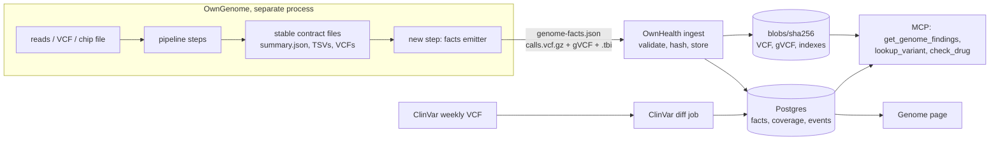
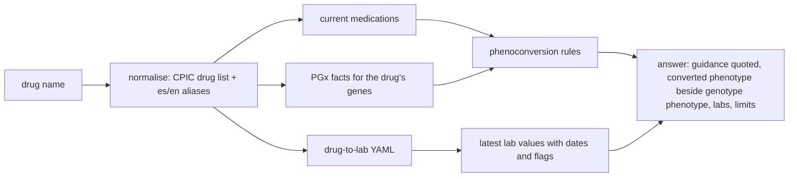
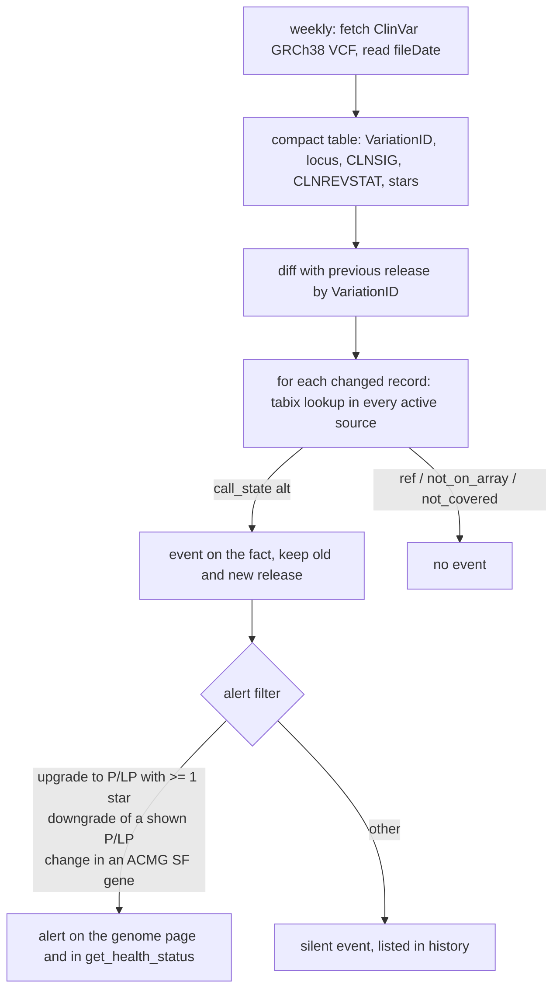

# Genome data in OwnHealth

Genome findings come from [OwnGenome](https://github.com/GeiserX/OwnGenome), our sibling project in the Own* family. It runs a whole-genome or chip analysis on your own hardware and writes the results to files. OwnHealth ingests its `genome-facts.json` and serves it next to your labs and medications. If you have a genome or a chip file and no findings yet, run OwnGenome first.

Status: design, pre-alpha. This page says how genome data enters OwnHealth, how it is stored, what the web page and the MCP server return, and what we will not do. Phases follow the [roadmap](../ROADMAP.md): v0.1 (facts ingest, VCF lookups, `check_drug` with PGx, current medications and labs), v0.3 (chip input, ClinVar diff, `check_drug` widened, CPIC/PharmCAT staleness, relatedness QC, family view), v1.0 (per-profile keys), v2 (FHIR Genomics Reporting export), moonshots (Phenopackets).

## 1. Division of labour

OwnGenome computes. OwnHealth ingests and serves. OwnHealth never calls variants, never imputes, never runs PharmCAT, pypgx, T1K or pgsc_calc.

| | OwnGenome (GPL-3.0-or-later, separate process) | OwnHealth (AGPL-3.0-or-later) |
|---|---|---|
| Inputs | FASTQ, BAM, CRAM, VCF, gVCF, ORA, long reads; consumer chip files (new chip mode) | the files OwnGenome writes |
| Work | alignment, calling, ClinVar screen, CPSR, PharmCAT + pypgx + CYP2D6 consensus, HLA, PRS with ancestry, traits, Lp(a) KIV-2, couple and family steps, imputation for chips | schema validation, storage, consent, the genome page, 3 MCP tools, ClinVar weekly diff, phenoconversion against today's med list, family views, exports |
| Output | `genome-facts.json` (`ownhealth.genome-facts/v1`) + tabix-indexed VCF/gVCF | facts in Postgres, raw files as blobs, events, audit |
| Re-annotation | VEP, PCGR, HLA DB, PGS Catalog, PharmCAT and CPIC re-runs | detects staleness, shows what to re-run, ingests the new file |

The interface is files, not code. OwnGenome runs as its own process (its CLI or Nextflow), writes a results folder, and OwnHealth reads it. No OwnGenome code is linked or copied into OwnHealth. This keeps the two licences apart and lets OwnGenome stay useful without OwnHealth. Any other pipeline that writes a valid `ownhealth.genome-facts/v1` file can feed OwnHealth too.



### What OwnGenome already produces (structure only)

OwnGenome 1.x keeps a CI-enforced output contract: `assets/output_contract.tsv` lists every result file with status `stable`, `experimental` or `internal`, and `docs/output-contract.md` says what counts as a break. The parts the facts step reads:

| Area | Files under `<sample>/` | Contract status |
|---|---|---|
| Run summary | `summary.json` (schema `tests/schema/summary.schema.json`): `run`, `databases` (ClinVar release, HLA DB), sections with `state`, `not_run`, `not_assessed` (list of strings) | stable |
| ClinVar screen | `clinvar/<s>_clinvar_hits.tsv` (`chrom,pos,ref,alt,genotype,clinvar_id,geneinfo,clnsig,clnrevstat`) | stable |
| Cancer predisposition | `cpsr/*.classification.tsv.gz` | stable |
| PGx | `pharmcat/<s>.report.json` and `.phenotype.json`; `cpic/<s>_phenotypes.tsv` (with optional `Phenoconverted_phenotype` when a `MEDICATIONS` list is given); `pypgx/`; `pgx_consensus/`; `cyrius/` | stable |
| HLA | `hla/<s>_hla_genotype.tsv` (T1K, 2-field) | stable |
| PRS | `prs/<s>_prs_summary.tsv` (`PGS_ID, Percentile, Matched_Pct, Ancestry_Group, Evaluated_In`, plus pgsc_calc ancestry-normalised outputs) | stable |
| Traits and APOE | `traits/<s>_traits.tsv`, genotype rules for multi-site haplotypes such as APOE | stable |
| Lp(a) | `lpa/<s>_lpa_kiv2.tsv` (KIV-2 copies with a 95% interval, plus rs10455872, rs3798220) | experimental |
| Couple and family | step 39 couple carrier screen, step 38 family analysis | experimental |
| Gene callability | `mosdepth/<s>_callability.bed.gz` over 1,572 hard genes | stable |
| Lookup semantics | `bin/genome_lookup.py`: gVCF reference blocks tell ref from not covered | tool |
| History | `history/<UTC>/` and `<s>_delta.json` from `bin/run_delta.py` | tool |
| Not reported on purpose | `docs/not-reported.md`: MTHFR as advice, diet panels, CYP1A2 heart risk, education PRS and others, each with PMIDs | doc |

What OwnGenome does not have yet, and must add for OwnHealth v0.1:

1. One normalised facts file with category, evidence level, confidence and call_state per finding (today each consumer would parse about 20 TSV layouts).
2. Stable variant keys on every finding: GA4GH VRS ID and ClinVar VariationID (today only the hits TSV has `clinvar_id`).
3. ACMG SF v3.3 tagging of findings in the 84 SF genes.
4. A structured coverage map replacing the `not_assessed` string list.
5. Sensitivity tags (APOE e4, SF cancer and cardiac genes, adult-onset).
6. A genotype fingerprint for identity checks.
7. Chip mode (v0.3): today chips follow a manual guide (`docs/chip-data-guide.md`); the new mode parses the vendor file, normalises to GRCh38 by dbSNP rsID position (the step 40 method), imputes locally, and emits the same facts file with capped confidence.

## 2. The contract: `ownhealth.genome-facts/v1`

OwnHealth owns the schema; it lives at `schemas/genome-facts.v1.json` in this repo. OwnGenome's facts step writes `<sample>/facts/<sample>_genome_facts.json`.

Versioning: within v1, producers may add optional fields and new `db_versions` keys. A removed or renamed field, a changed meaning or a new `category` value is v2. OwnHealth rejects a file whose `schema` string it does not know, with a visible error in the import log; nothing is half-imported.

### 2.1 Field rules

- `call_state` is required on every finding that rests on a genotype. Values: `ref`, `alt`, `no_call`, `not_on_array`, `not_covered`. Imputation is not a call_state; it is `genotype.imputed: true` with `r2`.
- `coverage[]` must list every gene of the fixed panels (ACMG SF v3.3, CPIC genes, the carrier gene list) and every hard gene the run could not read. "No finding" in a gene marked `not_assessed` is never shown as negative.
- `id` is deterministic: the first 16 hex characters of `sha256("v1|" + category + "|" + gene + "|" + key)`, where `key` is the VRS ID for a variant finding, the gene for a diplotype or HLA finding, the PGS ID for a PRS and the rule name for a multi-site rule (APOE). The id holds no sample id, so two sources of one person (a 2019 chip and a 2025 genome) produce the same id for the same finding, and a re-run diffs by id.
- Free-text fields (`summary`, `drug_guidance[].recommendation`, `limitations[]`) are capped at 2,000 characters, must not contain control characters, and are returned over MCP as `trust: untrusted_text`, because a facts file is an imported file like any PDF.
- The file carries no person names. OwnHealth maps `subject.sample_id` to a profile at import.

### 2.2 JSON Schema sketch

```json
{
  "$schema": "https://json-schema.org/draft/2020-12/schema",
  "$id": "urn:ownhealth:schema:genome-facts:v1",
  "type": "object",
  "required": ["schema", "subject", "assay", "provenance", "files", "coverage", "facts"],
  "properties": {
    "schema": { "const": "ownhealth.genome-facts/v1" },
    "subject": { "type": "object", "required": ["sample_id", "declared_sex"], "properties": {
      "sample_id": { "type": "string", "maxLength": 64 },
      "declared_sex": { "enum": ["female", "male", "unknown"] },
      "inferred_karyotype": { "enum": ["XX", "XY", "X0", "XXY", "XYY", "unknown"] },
      "fingerprint": { "type": "object", "required": ["panel", "genotypes"], "properties": {
        "panel": { "type": "string" }, "genotypes": { "type": "string", "pattern": "^[012.]+$" } } } } },
    "assay": { "type": "object", "required": ["type", "build"], "properties": {
      "type": { "enum": ["wgs", "wes", "long_read", "vcf_only", "chip", "chip_imputed"] },
      "platform": { "type": "string" },
      "build": { "const": "GRCh38" },
      "source_build": { "enum": ["GRCh37", "GRCh38"] },
      "mean_depth": { "type": "number" }, "callable_fraction": { "type": "number" },
      "imputation": { "type": "object", "properties": {
        "engine": { "enum": ["beagle_local", "michigan", "topmed"] },
        "panel": { "type": "string" }, "r2_min": { "type": "number" } } } } },
    "provenance": { "type": "object", "required": ["pipeline", "version", "generated_utc", "db_versions"], "properties": {
      "pipeline": { "type": "string" }, "version": { "type": "string" }, "commit": { "type": "string" },
      "generated_utc": { "type": "string", "format": "date-time" },
      "db_versions": { "type": "object", "additionalProperties": { "type": "string" } } } },
    "files": { "type": "array", "items": { "$ref": "#/$defs/file" } },
    "coverage": { "type": "array", "items": { "$ref": "#/$defs/coverage" } },
    "facts": { "type": "array", "items": { "$ref": "#/$defs/fact" } },
    "qc": { "type": "object", "properties": {
      "sex_check": { "enum": ["pass", "mismatch", "not_run"] },
      "contamination": { "type": "number" }, "identity": { "type": "string" } } }
  },
  "$defs": {
    "file": { "type": "object", "required": ["role", "path", "sha256"], "properties": {
      "role": { "enum": ["calls_vcf", "gvcf", "annotated_vcf", "chip_sites", "original"] },
      "path": { "type": "string" }, "sha256": { "type": "string", "pattern": "^[0-9a-f]{64}$" },
      "index_path": { "type": "string" }, "index_sha256": { "type": "string" }, "bytes": { "type": "integer" } } },
    "coverage": { "type": "object", "required": ["scope", "id", "state"], "properties": {
      "scope": { "enum": ["gene", "locus", "panel"] }, "id": { "type": "string" },
      "panel": { "enum": ["acmg_sf_v3.3", "cpic", "carrier", "callability", "other"] },
      "state": { "enum": ["assessed", "partial", "not_assessed"] },
      "reason": { "enum": ["not_on_array", "low_depth", "paralog", "sv_not_callable", "no_bam",
                           "required_positions_missing", "not_run", "assay_cannot_detect", "other"] },
      "fraction_callable": { "type": "number" }, "note": { "type": "string", "maxLength": 2000 } } },
    "variant": { "type": "object", "required": ["chrom", "pos", "ref", "alt"], "properties": {
      "chrom": { "type": "string" }, "pos": { "type": "integer" },
      "ref": { "type": "string" }, "alt": { "type": "string" },
      "rsid": { "type": "string", "pattern": "^rs[0-9]+$" }, "hgvs_c": { "type": "string" }, "hgvs_p": { "type": "string" },
      "vrs_id": { "type": "string", "pattern": "^ga4gh:VA\\." },
      "clinvar_variation_id": { "type": "integer" } } },
    "genotype": { "type": "object", "required": ["call_state"], "properties": {
      "call_state": { "enum": ["ref", "alt", "no_call", "not_on_array", "not_covered"] },
      "gt": { "type": "string" }, "zygosity": { "enum": ["het", "hom", "hemi", "ref", "unknown"] },
      "dp": { "type": "integer" }, "gq": { "type": "integer" },
      "imputed": { "type": "boolean" }, "r2": { "type": "number" }, "dosage": { "type": "number" } } },
    "evidence": { "type": "object", "required": ["level", "native"], "properties": {
      "level": { "enum": ["E1", "E2", "E3", "E4"] }, "native": { "type": "string" },
      "clinvar_stars": { "type": "integer", "minimum": 0, "maximum": 4 },
      "pmids": { "type": "array", "items": { "type": "integer" } },
      "tools": { "type": "array", "items": { "type": "string" } } } },
    "confidence": { "type": "object", "required": ["level", "basis"], "properties": {
      "level": { "enum": ["high", "medium", "low", "unconfirmed"] }, "basis": { "type": "string" } } },
    "drug_guidance": { "type": "object", "required": ["drug", "source", "level"], "properties": {
      "drug": { "type": "string" }, "rxnorm": { "type": "string" }, "source": { "enum": ["CPIC", "DPWG", "FDA"] },
      "level": { "type": "string" }, "phenotype": { "type": "string" },
      "recommendation": { "type": "string", "maxLength": 2000 }, "url": { "type": "string", "format": "uri" } } },
    "fact": { "type": "object", "required": ["id", "category", "summary", "evidence", "confidence", "sensitivity"], "properties": {
      "id": { "type": "string", "pattern": "^f_[0-9a-f]{16}$" },
      "category": { "enum": ["pgx", "monogenic_pathogenic", "acmg_sf", "carrier", "hla", "trait",
                             "risk_marker", "prs", "ancestry"] },
      "gene": { "type": "string" }, "hgnc_id": { "type": "string" },
      "variants": { "type": "array", "items": { "allOf": [ { "$ref": "#/$defs/variant" },
        { "properties": { "genotype": { "$ref": "#/$defs/genotype" } } } ] } },
      "value": { "type": "object", "description": "category-specific: diplotype, phenotype, activity_score, alleles, haplotype, score fields" },
      "summary": { "type": "string", "maxLength": 2000 },
      "condition": { "type": "object", "properties": { "name": { "type": "string" },
        "mondo": { "type": "string" }, "inheritance": { "enum": ["AD", "AR", "XL", "MT", "complex"] } } },
      "drug_guidance": { "type": "array", "items": { "$ref": "#/$defs/drug_guidance" } },
      "evidence": { "$ref": "#/$defs/evidence" },
      "confidence": { "$ref": "#/$defs/confidence" },
      "limitations": { "type": "array", "items": { "type": "string", "maxLength": 2000 } },
      "sensitivity": { "type": "object", "required": ["level"], "properties": {
        "level": { "enum": ["normal", "sensitive", "adult_onset"] }, "reason": { "type": "string" } } },
      "hidden_by_default": { "type": "boolean" },
      "confirm_clinically": { "type": "boolean" },
      "related_loinc": { "type": "array", "items": { "type": "string" } },
      "origin": { "type": "object", "properties": { "step": { "type": "string" }, "file": { "type": "string" } } }
    } }
  }
}
```

Two rules the schema cannot express, enforced by the importer: a fact with `variants[]` must carry `genotype.call_state` on each; `confidence.level` must be `unconfirmed` for any `monogenic_pathogenic`, `acmg_sf` or `carrier` fact from `assay.type` `chip`.

### 2.3 Synthetic example

Profile Alex Rivera, sample `AR-01`, 30x WGS. Every value is invented for illustration; coordinates, PGS ID, LOINC codes and the ClinVar id must be checked against dbSNP, PGS Catalog, LOINC and ClinVar before this file becomes a test fixture (unverified). Long ids are shortened with `…`.

```json
{
  "schema": "ownhealth.genome-facts/v1",
  "subject": { "sample_id": "AR-01", "declared_sex": "male", "inferred_karyotype": "XY",
               "fingerprint": { "panel": "ownhealth-fp-v1", "genotypes": "0121012001…" } },
  "assay": { "type": "wgs", "platform": "Illumina 30x", "build": "GRCh38", "mean_depth": 33.8, "callable_fraction": 0.94 },
  "provenance": { "pipeline": "OwnGenome", "version": "1.4.0", "commit": "abc1234", "generated_utc": "2026-10-14T09:15:00Z",
                  "db_versions": { "clinvar": "2026-10-06", "pharmcat": "3.1.0", "cpic": "2026-09", "ipd_imgt_hla": "3.62", "pgs_catalog": "2026-08" } },
  "files": [
    { "role": "calls_vcf", "path": "vcf/AR-01.vcf.gz", "sha256": "3f9a…", "index_path": "vcf/AR-01.vcf.gz.tbi", "index_sha256": "77c1…" },
    { "role": "gvcf", "path": "vcf/AR-01.g.vcf.gz", "sha256": "c02e…", "index_path": "vcf/AR-01.g.vcf.gz.tbi", "index_sha256": "9b4d…" } ],
  "coverage": [
    { "scope": "gene", "id": "CYP2D6", "panel": "cpic", "state": "assessed", "note": "pypgx and Cyrius agree" },
    { "scope": "gene", "id": "BRCA2", "panel": "acmg_sf_v3.3", "state": "assessed", "fraction_callable": 0.998 },
    { "scope": "gene", "id": "PMS2", "panel": "acmg_sf_v3.3", "state": "partial", "reason": "paralog", "fraction_callable": 0.81 },
    { "scope": "gene", "id": "FMR1", "panel": "carrier", "state": "not_assessed", "reason": "not_run" } ],
  "facts": [
    { "id": "f_1a2b3c4d5e6f7081", "category": "pgx", "gene": "CYP2C19",
      "variants": [ { "chrom": "chr10", "pos": 94781859, "ref": "G", "alt": "A", "rsid": "rs4244285", "vrs_id": "ga4gh:VA.…",
                      "genotype": { "call_state": "alt", "gt": "0/1", "zygosity": "het", "dp": 31, "gq": 60 } } ],
      "value": { "diplotype": "*1/*2", "phenotype": "Intermediate Metabolizer" },
      "summary": "Reduced CYP2C19 function.",
      "drug_guidance": [ { "drug": "clopidogrel", "source": "CPIC", "level": "A", "phenotype": "Intermediate Metabolizer",
                           "recommendation": "<CPIC text, verbatim>", "url": "https://cpicpgx.org/guidelines/" } ],
      "evidence": { "level": "E1", "native": "CPIC A", "tools": ["PharmCAT", "pypgx"] },
      "confidence": { "level": "high", "basis": "two callers agree" }, "sensitivity": { "level": "normal" } },
    { "id": "f_2b3c4d5e6f708192", "category": "pgx", "gene": "SLCO1B1",
      "variants": [ { "chrom": "chr12", "pos": 21178615, "ref": "T", "alt": "C", "rsid": "rs4149056",
                      "genotype": { "call_state": "alt", "gt": "0/1", "zygosity": "het", "dp": 29, "gq": 58 } } ],
      "value": { "diplotype": "*1/*5", "phenotype": "Decreased Function" },
      "summary": "Reduced hepatic uptake of some statins.",
      "drug_guidance": [ { "drug": "atorvastatin", "source": "CPIC", "level": "A", "recommendation": "<CPIC text, verbatim>" } ],
      "evidence": { "level": "E1", "native": "CPIC A" }, "confidence": { "level": "high", "basis": "single SNV, GQ 58" },
      "sensitivity": { "level": "normal" }, "related_loinc": ["2157-6", "1742-6"] },
    { "id": "f_3c4d5e6f70819203", "category": "hla", "gene": "HLA-B",
      "value": { "alleles": ["HLA-B*07:02", "HLA-B*44:02"], "marker": "HLA-B*58:01", "present": false },
      "summary": "HLA-B*58:01 not detected. CPIC ties this allele to severe skin reactions with allopurinol.",
      "drug_guidance": [ { "drug": "allopurinol", "source": "CPIC", "level": "A", "phenotype": "HLA-B*58:01 negative",
                           "recommendation": "<CPIC text, verbatim>", "url": "https://cpicpgx.org/guidelines/" } ],
      "evidence": { "level": "E1", "native": "CPIC A" },
      "confidence": { "level": "medium", "basis": "T1K 2-field typing from reads" },
      "sensitivity": { "level": "normal" } },
    { "id": "f_4d5e6f7081920314", "category": "risk_marker", "gene": "APOE",
      "variants": [ { "chrom": "chr19", "pos": 44908684, "ref": "T", "alt": "C", "rsid": "rs429358", "genotype": { "call_state": "alt", "gt": "0/1", "zygosity": "het" } },
                    { "chrom": "chr19", "pos": 44908822, "ref": "C", "alt": "T", "rsid": "rs7412", "genotype": { "call_state": "ref", "gt": "0/0" } } ],
      "value": { "haplotype": "e3/e4" },
      "summary": "APOE e3/e4. Raises average Alzheimer's disease risk compared with e3/e3; it is not a diagnosis.",
      "evidence": { "level": "E2", "native": "replicated association with effect size" },
      "confidence": { "level": "high", "basis": "both sites called, GQ > 50" },
      "sensitivity": { "level": "adult_onset", "reason": "APOE e4" } },
    { "id": "f_5e6f708192031425", "category": "risk_marker", "gene": "LPA",
      "variants": [ { "chrom": "chr6", "pos": 160589086, "ref": "A", "alt": "G", "rsid": "rs10455872", "genotype": { "call_state": "alt", "gt": "0/1", "zygosity": "het" } } ],
      "value": { "kiv2_copies": 18, "kiv2_ci95": [15, 22] },
      "summary": "LPA risk allele and a low KIV-2 copy estimate, both linked to higher Lp(a). A single Lp(a) blood test is the measurement that counts.",
      "evidence": { "level": "E2", "native": "replicated association" },
      "confidence": { "level": "medium", "basis": "depth estimate, experimental step" },
      "limitations": ["The SNPs were found in European cohorts."], "sensitivity": { "level": "normal" },
      "related_loinc": ["10835-7", "43583-4"] },
    { "id": "f_6f70819203142536", "category": "carrier", "gene": "CFTR",
      "variants": [ { "chrom": "chr7", "pos": 117559590, "ref": "ATCT", "alt": "A", "rsid": "rs113993960", "hgvs_p": "p.Phe508del",
                      "clinvar_variation_id": 7105, "genotype": { "call_state": "alt", "gt": "0/1", "zygosity": "het", "dp": 35, "gq": 99 } } ],
      "condition": { "name": "Cystic fibrosis", "inheritance": "AR" },
      "summary": "Heterozygous carrier of a pathogenic CFTR variant. Carriers are not affected; it matters for a partner's testing.",
      "evidence": { "level": "E1", "native": "ClinVar Pathogenic, 3 stars", "clinvar_stars": 3 },
      "confidence": { "level": "high", "basis": "GQ 99, DP 35" }, "sensitivity": { "level": "normal" } },
    { "id": "f_708192031425364a", "category": "prs",
      "value": { "condition": "coronary artery disease", "pgs_id": "PGS000018", "z_norm2": 1.08, "percentile": 86,
                 "matched_pct": 97.2, "reference": "HGDP+1kGP", "most_similar_pop": "EUR", "evaluated_in": ["EUR"] },
      "summary": "Higher than 86% of the EUR reference group for this score.",
      "evidence": { "level": "E3", "native": "PGS Catalog score with published evaluation" },
      "confidence": { "level": "medium", "basis": "matched 97% of variants; ancestry inside evaluation set" },
      "limitations": ["Percentile is relative to the EUR reference group of HGDP+1kGP after pgsc_calc ancestry normalisation; it is not an absolute risk and is not valid for ancestries outside the evaluation set."],
      "sensitivity": { "level": "normal" } },
    { "id": "f_8192031425364a5b", "category": "trait", "gene": "MTHFR",
      "variants": [ { "chrom": "chr1", "pos": 11796321, "ref": "G", "alt": "A", "rsid": "rs1801133", "genotype": { "call_state": "alt", "gt": "0/1" } } ],
      "summary": "MTHFR C677T heterozygous: enzyme note only.",
      "evidence": { "level": "E4", "native": "not supported as health advice (PMID 23288205)" },
      "confidence": { "level": "high", "basis": "GQ 60" }, "sensitivity": { "level": "normal" }, "hidden_by_default": true } ]
}
```

## 3. Evidence, confidence, call_state, coverage

Evidence says how well the science supports the reading. Confidence says how sure we are about this person's call. Both always travel together, with the source-native label.

| Level | Meaning | Native labels mapped here | Default display |
|---|---|---|---|
| E1 | Guideline or expert-curated | CPIC A/B, DPWG guideline; ClinVar P/LP with 2 to 4 stars; ClinGen-curated; ACMG SF v3.3 gene rules met | shown |
| E2 | Replicated, weaker curation | ClinVar P/LP 1 star; CPIC C; replicated association with an effect size (APOE, LPA SNPs, F5 Leiden) | shown |
| E3 | Single study or statistical | ClinVar P/LP 0 stars; single-study associations; every PRS | shown, labelled |
| E4 | Popular but unsupported | MTHFR as advice, diet panels, CYP1A2 heart risk, entries of OwnGenome's `not-reported.md` | hidden; shown only on request, always with the badge and the reason |

| Confidence | When |
|---|---|
| high | WGS call passing depth and GQ thresholds; CYP2D6 with two callers agreeing |
| medium | single caller, depth estimates with intervals, chip-genotyped common SNVs, imputed with R2 >= 0.9 and MAF >= 1% |
| low | chip HLA tags, CYP2D6 from a VCF or chip, other imputed sites |
| unconfirmed | rare P/LP from a chip; any finding OwnHealth extracted from a clinical report PDF until a human confirms it |

| call_state | WGS with gVCF | Chip |
|---|---|---|
| `ref` | inside a reference block passing GQ | on the array, homozygous reference |
| `alt` | variant genotype called | on the array, non-reference genotype |
| `no_call` | `./.`; or variant-only VCF with no record (absence cannot be told from ref; reason says so) | `--` or `0` in the vendor file |
| `not_on_array` | not used | position not probed by this chip |
| `not_covered` | no reference block, or block below GQ/depth threshold | not used |

Coverage map: OwnHealth stores `coverage[]` per source and answers every gene question from it first. A gene query on PMS2 above returns "partial (paralog), 81% callable" before any variant list. The genome page shows one coverage strip per panel.

## 4. Consumer chips (v0.3, through OwnGenome)

| Vendor | File | Layout | Traps |
|---|---|---|---|
| 23andMe v3/v4/v5 | `.txt` in a zip | `rsid chromosome position genotype`, `#` header | `--` no-call; `i`-prefixed internal ids without rsIDs; haploid MT/Y |
| AncestryDNA v1/v2 | `.txt` | `rsid chromosome position allele1 allele2` | chromosomes 23=X, 24=Y, 25=PAR, 26=MT; `0` no-call |
| MyHeritage, FTDNA | `.csv` | `RSID,CHROMOSOME,POSITION,RESULT`, quoted | old FTDNA files may be build 36 (unverified) |
| LivingDNA | `.txt` | 23andMe-like | |

The OwnGenome chip mode: detect vendor and version, resolve REF from FASTA, drop ambiguous A/T and C/G sites unless dbSNP resolves strand, move to GRCh38 by dbSNP rsID position (not chain liftover), write a VCF of every called site plus a `chip_sites` file listing probed positions (this is what makes `not_on_array` exact), then run PharmCAT with Required Positions, the traits and APOE rules, the ClinVar screen, HLA tag SNPs and ancestry. Imputation runs locally with Beagle 5 (licence GPL-3.0, unverified) and the 1000G 30x GRCh38 phased panel; Michigan and TopMed servers need an upload of the genotypes and stay an explicit opt-in inside OwnGenome.

Confidence caps by assay:

| Finding | WGS (BAM-based) | WGS vcf_only | chip | chip_imputed |
|---|---|---|---|---|
| common PGx SNV | high | high | medium | low (medium if R2 >= 0.9) |
| CYP2D6 | high (two callers) / medium (probable) | low | low | not called |
| rare P/LP | high if depth/GQ pass | medium | unconfirmed | never reported |
| HLA | medium to high | not called | low, not for prescribing | low, not for prescribing |
| PRS | per `matched_pct` | per `matched_pct` | not called | per `matched_pct` and R2 |

Never reported from chips: CYP2D6 deletions, duplications and hybrids (they are invisible on arrays; the CYP2D6 fact says so); HLA calls as prescribing input; PRS without imputation; repeat expansions, SVs, copy number (SMN1), mitochondrial heteroplasmy; imputed variants with MAF < 1%; and any "not detected" reassurance. A chip without BRCA hits says "3 founder variants probed; the rest of BRCA1 and BRCA2 not assessed", written into the fact, not a footnote. A rare P/LP from a chip shows as unconfirmed with "array calls of very rare variants are mostly false; a clinical-grade test is needed" (PPV about 16% for very rare variants in UK Biobank arrays, PMID 33589468).

Two sources for one person (a chip and a genome): both are kept. Facts merge by `id`; the higher confidence wins the display; agreement shows "concordant across 2 assays"; disagreement at one site becomes a visible QC item. On import, OwnHealth compares the new source's `fingerprint` with the profile's existing sources and blocks the import below 95% concordance, which catches sample swaps.

## 5. Raw data storage and lookups

Raw genome files never enter Postgres. The facts file (kilobytes) is parsed into tables; the VCF, gVCF and their `.tbi` indexes go to the content-addressed blob store (`blobs/sha256/ab/cd/...`) after their sha256 matches the facts file.

| Table | Holds |
|---|---|
| `genome_source` | profile, assay, build, OwnGenome version, db_versions, blob hashes, import time, status (`active`, `superseded`) |
| `genome_fact` | FHIR-shaped JSONB of the fact plus projection columns: `fact_id`, `category`, `gene`, `evidence_level`, `confidence`, `sensitivity`, `hidden_by_default`; one row per source |
| `genome_fact_status` | OwnHealth-side state per profile and fact id: lifecycle (`provisional`, `current`, `superseded`, `retracted`) and, beside it, clinical verification (`provisional`, `confirmed`), each with author, reason and `src`. Facts stay immutable; status lives beside them |
| `genome_coverage` | per source, gene or locus, state, reason |
| `genome_event` | reinterpretation and re-run events (section 9) |
| `ref_rsid` | curated rsID to GRCh38 index |

CRAM and BAM are not stored. A source may record a pointer (path, size, sha256) so the coverage map can say which re-derivations are possible; without reads, CYP2D6 SVs, Lp(a) KIV-2, HLA re-typing and SV re-calls cannot be redone, and OwnHealth says so.

Lookups use pysam `TabixFile` on the blob paths (indexes passed explicitly, since blob names are hashes). The `ref_rsid` table is the union of the consumer array sites (23andMe, AncestryDNA, MyHeritage, LivingDNA), PharmCAT positions, ClinVar rsIDs and the trait panel, taken from dbSNP (public domain), shipped as a versioned bgzipped TSV and loaded by a migration. Expected size: a few million rows (unverified). Full dbSNP is not shipped. Remote rsID resolution (NCBI or Ensembl) leaks what the person is interested in and is off; an rsID outside the index returns `rsid_unknown` with a hint to ask by position.

HGVS input: `NC_` genomic HGVS on GRCh38 is parsed directly. Transcript HGVS (`c.`) resolves only when the `ref_rsid` index or the person's annotated VCF (VEP `HGVSc`) has it; otherwise `hgvs_unresolved`. We do not ship a transcript mapper in v0.1.

## 6. MCP genome tools

Three of the eight v0.1 tools touch the genome. `tools/list` hides a tool when the token lacks its scope.

| Tool | Scope | Behaviour |
|---|---|---|
| `get_genome_findings(profile, category?, gene?)` | `read:genome` | Facts with evidence, confidence, call_state, status and `src`. Default omits E4. With `gene`, returns the coverage entry first; a `not_assessed` gene returns that state, never an empty list. Summary form by default (~60 tokens per fact), cursor pagination |
| `lookup_variant(profile, rsid\|hgvs\|region)` | `read:genome_raw` | Explicit call_state, gt, dp, gq, ClinVar annotation of the person's own record, and the fact ids that cite the site. Region <= 1 Mb, 50 records per page. Daily cap per token (default 200 lookups); defaults live in [mcp.md section 9.4](mcp.md#94-rate-limits-and-egress-budgets) |
| `check_drug(profile, drug)` | `read:genome`, plus `read:records` for meds and `read:labs` for labs | Section 8. Missing scopes degrade the answer and are listed in `not_assessed` |

Response envelope for every genome answer (fixed field names):

```json
{
  "data": [ { "fact_id": "f_2b3c4d5e6f708192", "gene": "SLCO1B1", "summary": "Reduced hepatic uptake of some statins.",
              "value": { "diplotype": "*1/*5", "phenotype": "Decreased Function" },
              "evidence": { "level": "E1", "native": "CPIC A" }, "confidence": "high", "call_state": "alt",
              "status": "current", "verification": "provisional", "src": "src_g2b3c4d5e", "trust": "untrusted_text" } ],
  "evidence": "E1-E3 shown; E4 hidden",
  "limitations": ["Assay WGS 30x; CRAM not on file, SV re-calls not possible"],
  "not_assessed": [ { "gene": "FMR1", "reason": "not_run" } ],
  "sensitive_withheld": 1,
  "db_versions": { "clinvar": "2026-10-06", "pharmcat": "3.1.0", "cpic": "2026-09" },
  "notice": "Information for personal records, not a diagnosis."
}
```

Safety envelope, enforced in the server, not left to prompts:

- **Sensitive gating covers lookups too.** With sensitive sharing off, `lookup_variant` on a site or region inside a sensitive gene (APOE, SF cancer and cardiac genes, HTT and other predictive repeat loci) returns `withheld_sensitive` and no genotype. Otherwise an agent could read APOE through rs429358 and bypass the opt-in. Regions overlapping such a gene are clipped and the clip is reported.
- **No silent negatives.** Absence is answered with a call_state or a coverage state.
- **No write or delete.** No MCP tool imports, edits or deletes genome data or creates an export. The only agent write is `propose(kind=finding_status)`, which lands in the review queue (for example, a clinical report confirms a chip variant).
- **Untrusted text.** Free text from the facts file is marked `trust: untrusted_text`.
- **Audit.** Every genome call logs token, tool, profile, the query (rsID, gene or region) and the fact ids returned, never genotypes. The profile's access history shows it.
- **Budget.** Genome answers obey the 4k default and 15k maximum token budget; `get_genome_findings` without filters returns category counts plus E1 and E2 facts first.

`get_source(src_id)` on a genome `src` returns the source assay, OwnGenome version, the contract file the fact came from (`origin.file`), db_versions and the import time.

## 7. Consent, sensitive findings, minors

Per-profile settings, changed only by the profile owner (or a guardian for a minor, within the limits below), each change audited:

| Setting | Default | Effect |
|---|---|---|
| `genome.sensitive.ui` | off | Sensitive and adult-onset facts show as a locked row ("1 sensitive result hidden"). Reveal shows an explanation first (what the finding means, what it does not mean, a pointer to genetic counselling) and asks for confirmation per finding |
| `genome.sensitive.agents` | off | Sensitive facts and lookups of sensitive genes appear in MCP answers. Separate from the UI setting: seeing your APOE result yourself is not consent to hand it to an agent |
| `genome.share.<person>` | none | Per relative and per category (`pgx`, `carrier`, `cascade`), section 10 |

Sensitive list v1: APOE e4 (any copy), ACMG SF v3.3 cancer and cardiac genes, HTT and other predictive neurological repeats. OwnHealth applies its own gene list in addition to the producer's `sensitivity` tag, and CI checks that the two lists agree.

Minors (profile age under 18 by birth date):

- Withheld from the UI and MCP until the person turns 18: `adult_onset` facts, `sensitive` facts, carrier status, PRS for adult-onset conditions. They are stored (the file holds them) but not served.
- Shown to guardians: PGx (it guides children's prescriptions, for example TPMT/NUDT15 with thiopurines, CYP2C19 with PPIs), childhood-onset actionable findings, HLA, traits.
- At 18, the person gets a notice that withheld results exist and decides about each reveal. Guardian access ends unless the person grants it again.

## 8. `check_drug`: PGx joined with meds and labs



Steps:

1. Normalise the drug against the CPIC drug list (names and RxNorm ids from the CPIC API snapshot) plus our alias table (es/en first: "omeprazol", "codeína"). No match returns `drug_unknown`, never "no interaction".
2. Collect the PGx facts of the genes CPIC and DPWG tie to that drug, with confidence, and every gene the facts call `not_assessed`.
3. Phenoconversion against the current medication list, with CPIC's published rule for CYP2D6 (v0.1): a strong inhibitor sets the activity score to 0 (poor metabolizer), a moderate inhibitor multiplies it by 0.5. The converted phenotype is shown beside the genotype phenotype, never in place of it. CYP2C19, CYP2C9 and CYP3A have no CPIC conversion rule: the answer says "phenoconversion not computed" in v0.1, and from v0.3 it also names the inhibitor per gene. The inhibitor table is our own cited YAML built from the FDA table of clinical CYP inhibitors; CI cross-checks it against OwnGenome's `assets/pgx_inhibitors.tsv` so the two never drift.
4. Guidance text is quoted from the facts file for the genotype phenotype. When phenoconversion changes the phenotype, the CPIC recommendation for the converted phenotype comes from the bundled CPIC snapshot (CPIC content licence CC0, unverified), labelled as such.
5. Relevant labs from a cited YAML (`drug_labs.yaml`, drug to LOINC with reason): statins to CK and ALT, warfarin to INR. Latest value, date, the lab's own flag, and stale if outside the rule pack's recency window.
6. Answer wording: CPIC text with level and URL (DPWG text beside it from v0.3), then "discuss with your prescriber". Never "do not take".

Example: `check_drug("Sam Rivera", "codeine")`, Sam is CYP2D6 *1/*1 (activity score 2.0, normal metabolizer) and takes paroxetine:

```json
{
  "data": { "drug": "codeine", "genes": [ {
      "gene": "CYP2D6", "genotype_phenotype": "Normal Metabolizer", "activity_score": 2.0,
      "phenoconverted": { "phenotype": "Poor Metabolizer", "activity_score": 0, "by": "paroxetine (strong CYP2D6 inhibitor)", "rule": "CPIC opioid guideline" },
      "guidance": [ { "source": "CPIC", "level": "A", "for_phenotype": "Poor Metabolizer", "text": "<CPIC text, verbatim>", "origin": "cpic_snapshot", "url": "https://cpicpgx.org/guidelines/" } ],
      "confidence": "high", "src": "src_g9d1e" } ],
    "current_medications": [ { "name": "paroxetine", "src": "src_m51a0" } ],
    "labs": [] },
  "limitations": ["Phenoconversion uses the medication list as recorded; check it is current."],
  "not_assessed": [],
  "notice": "Discuss with your prescriber."
}
```

v0.1 ships all of the above: PGx facts, current medications (from FHIR/IPS, Apple Health and manual entry), relevant labs and the CYP2D6 phenoconversion rule. v0.3 widens it: supplements join the medication list, inhibitors are named per gene beyond CYP2D6, and DPWG text sits beside CPIC.

Gene x lab rules in the deterministic status use the same `related_loinc` links. Examples: LPA to Lp(a) ("never measured" is a status item once an LPA risk fact exists), SLCO1B1 decreased function on a statin to CK, G6PD deficiency to haemoglobin, TPMT or NUDT15 on a thiopurine to the blood count.

## 9. Reinterpretation alerts (v0.3)



- Event types: `upgraded_to_plp`, `downgraded_from_plp`, `stars_changed`, `became_conflicting`, `vus_resolved`, `new_assertion_on_carried_variant`. Each keeps both ClinVar releases and the fact's previous version.
- The diff is a lookup over the person's own calls, not re-annotation: no VEP, no BAM. Chip sources get the same diff; their events inherit `unconfirmed` and read "worth a clinical test", not an alarm.
- Sensitive and minor gating apply to alerts: a withheld fact's alert shows as "a withheld result changed".
- CPIC and PharmCAT: a weekly check of CPIC API guideline dates and PharmCAT releases marks affected PGx facts `stale` with the release that superseded their `db_versions`. OwnHealth does not re-run PharmCAT; the page names the OwnGenome steps to re-run (7, 27, 36). The same holds for VEP, PCGR, IPD-IMGT/HLA and PGS Catalog updates.
- Re-run ingest: a new facts file for an existing source supersedes the old one; OwnHealth diffs facts by `id` (added, removed, value changed, evidence or confidence changed) and writes events with the same filter. We do not need OwnGenome's `_delta.json` for this.
- External notification channels (ntfy, email) come in v2; until then alerts surface in the UI and in `get_health_status`.

## 10. Family and cascade view (v0.3)

Each relative's genome stays in their own profile. Nothing crosses profiles without a grant from the profile owner, and the view never reveals that a relative has genome data they did not share.

- **Carrier couple screen.** When two profiles are partners in the pedigree and both granted `carrier` to each other, OwnHealth joins their carrier facts by gene: shared AR gene (1 in 4 per pregnancy when both heterozygous), X-linked findings from either partner, and one-partner-only genes. The join covers whatever the facts hold, including SMN1 copy loss and repeat carriers from WGS. Each row carries residual-risk text: a chip or an unassessed gene in the partner means "not detected" is not "not a carrier". The page recommends a clinical carrier test and genetic counselling before any reproductive decision.
- **Cascade.** A P/LP finding (`monogenic_pathogenic`, `acmg_sf`) in Alex lists first-degree relatives from the pedigree with "cascade testing is usually offered to relatives". If Carmen Ortega (parent) granted `cascade` to Alex, the row shows only Carmen's call_state at that one variant (`alt`, `ref`, `not_on_array`, `not_covered`), never her other findings. Relatives without a profile can hold a manually entered result from a clinical report, with the document as `src`.
- **Relatedness QC.** Fingerprints of family profiles are compared at import; a parent-child pair sharing almost no alleles is flagged for review, not silently linked.
- **Minors in the family.** Lucía Rivera (child) is never included in a carrier join or cascade row until she is 18.

## 11. Exports

- **FHIR Genomics Reporting IG STU3 (v3.0.0, FHIR R4)**, from the UI only, never over MCP. Mapping: the source becomes `GenomicReport` + `GenomicStudy`; each variant a `Variant` Observation (ClinVar VariationID and VRS in `variation-code`); P/LP a `DiagnosticImplication`; PGx diplotypes a `Genotype` Observation; drug guidance a `TherapeuticImplication`. PRS, traits and ancestry have no fitting profile and are left out of the export by default. Phase: v2.
- **Phenopackets v2** (ISO 4454:2022): moonshot, for sending a case with HPO terms and family to a rare-disease clinic.
- The doctor summary (v0.3) includes PGx takeaways and confirmed E1/E2 findings, never sensitive facts unless the owner ticks them for that print.

## 12. What we will not do

- Diagnose, or turn a finding into an instruction. PGx quotes CPIC/DPWG and says "discuss with your prescriber".
- Show an E4 claim (MTHFR "methylation", diet panels, CYP1A2 heart risk, education PRS) without its evidence badge and the reason it is not supported. They are hidden by default.
- Run genome engines in the app: no variant calling, imputation, PharmCAT, HLA typing or PRS computation.
- Upload genotypes anywhere. Imputation servers stay an opt-in inside OwnGenome; remote rsID lookups are off.
- Show a percentile for a PRS whose coverage is below 75% or whose ancestry is outside the evaluation set: the answer is "not interpretable for this person".
- Use chip HLA tags for prescribing, or read a negative chip as reassurance.
- Read health meaning into haplogroups, or use SNPedia text (CC BY-NC-SA).
- Offer Beacon or htsget endpoints; a family has no use for them and they add attack surface.
- Let an agent import, change, delete or export genome data.

## 13. Phases

| Phase | Genome work |
|---|---|
| v0.1 | OwnGenome facts step (separate repo); schema `ownhealth.genome-facts/v1` in this repo; ingest with validation, sha256 and fingerprint checks; VCF copied into blob storage; genome page with categories, coverage strip, sensitive locks; `get_genome_findings`, `lookup_variant`, `check_drug` (PGx + current medications + labs, CYP2D6 phenoconversion); consent settings (UI and agents); minors gating; audit |
| v0.3 | OwnGenome chip mode with local Beagle; ClinVar weekly diff and alerts; CPIC/PharmCAT staleness; relatedness QC; `check_drug` widened (supplements, inhibitors named per gene, DPWG); carrier couple screen and cascade view; doctor summary PGx block |
| v1.0 | per-profile data keys so a genome can be crypto-shredded; break-glass rules for genome data (sensitive facts excluded) |
| v2 | FHIR Genomics Reporting IG export, from the UI only |
| Moonshot | Phenopackets v2 export; research donation with explicit consent |

## 14. Open decisions

1. **Facts producer timing.** OwnHealth v0.1 genome work needs the OwnGenome facts step. If that step slips, OwnHealth has nothing to ingest, and parsing OwnGenome's TSVs inside OwnHealth would break "OwnHealth only ingests". Proposal: block v0.1 genome work on the OwnGenome step.
2. **Schema file licence.** The schema lives in an AGPL repo, but GPL and MIT producers must emit it. Proposal: license `schemas/genome-facts.v1.json` CC0-1.0.
3. **Age of majority.** 18 by default, configurable. Spain gives some health autonomy from 16 (unverified for genetic results). Open: whether the setting is per household or per profile.
4. **Reference mode for large files.** v0.1 copies the VCF, gVCF and indexes into the blob store. A 3 to 10 GB gVCF copied this way doubles disk use. Open: a later "reference mode" that verifies the sha256 at registration and weekly instead of copying.
5. **Chip-only users.** Chips go through OwnGenome, which needs Docker and its reference bundle, so a chip-only user has to install OwnGenome. Accept, or ship a small OwnGenome chip-mode image in an opt-in compose profile (still a separate GPL process, outside the app)?
6. **Unverified facts to check before fixtures ship:** coordinates in section 2.3, PGS000018 as the CAD score, LOINC 10835-7 and 43583-4 for Lp(a), ClinVar 7105 stars, Beagle and CPIC licences, the FDA inhibitor classes used in examples, the `ref_rsid` row count.

Decided: a sensitive genome fact reaches an agent only when the profile's `genome.sensitive.agents` switch is on and the token has both `read:genome` and `read:sensitive` ([mcp.md section 9.7](mcp.md)). Carrier status is withheld for minors (section 7), and the FHIR Genomics Reporting export ships in v2.

## Sources

https://github.com/GeiserX/OwnGenome
https://hl7.org/fhir/uv/genomics-reporting/STU3/
https://www.ga4gh.org/product/variation-representation/
https://phenopacket-schema.readthedocs.io/
https://pharmcat.clinpgx.org/faqs/
https://pharmcat.clinpgx.org/using/Outside-Call-Format/
https://api.cpicpgx.org
https://cpicpgx.org/guidelines/
https://search.clinicalgenome.org/kb/genes/acmgsf
https://ftp.ncbi.nlm.nih.gov/pub/clinvar/vcf_GRCh38/
https://pgsc-calc.readthedocs.io/en/latest/explanation/geneticancestry.html
https://imputationserver.sph.umich.edu/
https://statgen.github.io/tis-v2-docs/imputation/reference-panel/
https://www.fda.gov/drugs/drug-interactions-labeling/healthcare-professionals-fdas-examples-drugs-interact-cyp-enzymes-and-transporter-systems
https://pubmed.ncbi.nlm.nih.gov/33589468/
https://pubmed.ncbi.nlm.nih.gov/23288205/
https://pubmed.ncbi.nlm.nih.gov/40568962/
