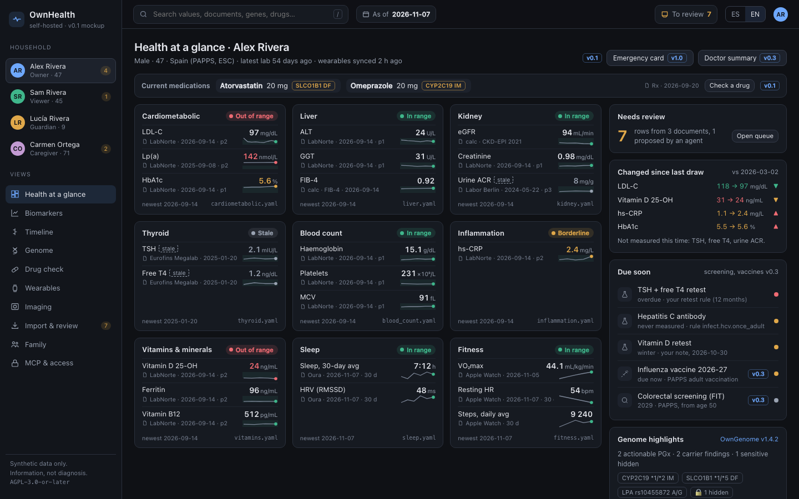

---
hide:
  - navigation
---

# OwnHealth

<!-- Home proposal B, docs first. The picked banner goes above the badges, and the H1 then takes { .oh-visually-hidden }. -->

  
  
  
  

The health data layer you own: labs, records, wearables and genome in one self-hosted store, with a web dashboard and an MCP server for your own agent. There is no AI model inside; the agent is yours, and it sees only what its token allows. Start with the [Quick start](quickstart.md), then connect your agent with the [MCP tool reference](mcp-tools.md).

!!! warning "Pre-alpha, version 0.4.0"
    Expect breaking changes before 1.0. Upgrades keep your data. OwnHealth gives information, never a diagnosis.

-   :lucide-rocket: **[Quick start](quickstart.md)**

    ---

    From nothing to your first lab report in about ten minutes, with Docker Compose and a passkey.

-   :lucide-inbox: **[Recipes](recipes/README.md)**

    ---

    Have data arrive by itself: a mailbox, a scanner folder, Paperless-ngx, an iPhone, Gadgetbridge, Nightscout.

-   :lucide-plug: **[MCP tool reference](mcp-tools.md)**

    ---

    The 10 tools, their scopes and limits, with real responses from the demo household.

-   :lucide-calculator: **[Calculators](calculators/README.md)**

    ---

    eGFR, FIB-4, HOMA-IR, SCORE2 and PREVENT, each with its citation and sourced inputs.

-   :lucide-scan-text: **[Agent-assisted extraction](agent-extraction.md)**

    ---

    Your own agent reads scans and photos over MCP and proposes values for you to review.

-   :lucide-globe: **[Guideline files](guidelines.md)**

    ---

    Add a country's screenings and vaccines as a cited data file.

-   :lucide-layers: **[Architecture](design/architecture.md)**

    ---

    The components, the PostgreSQL schema, the job queue and the rule pack.

-   :lucide-shield-check: **[Security and privacy](design/security-privacy.md)**

    ---

    Trust boundaries, the threat model, prompt injection, keys and the audit log.

## All pages

### Get started

- [Quick start](quickstart.md): install, first account, first lab report, first agent.
- [Recipes](recipes/README.md): one page per inbox or connection.
    - [Email](recipes/email.md), [Paperless-ngx](recipes/paperless-ngx.md), [Scanner to folder](recipes/scanner-to-folder.md), [Health Auto Export](recipes/health-auto-export.md), [Gadgetbridge](recipes/gadgetbridge.md), [Nightscout](recipes/nightscout.md), [iOS Shortcut](recipes/ios-shortcut.md), [claude.ai remote connector](recipes/claude-connector.md).
- [Agent-assisted extraction with Claude Code](agent-extraction.md): scans read by your agent, not by OwnHealth.

### Reference

- [MCP tool reference](mcp-tools.md): every tool, scope, error and resource.
- [Calculators](calculators/README.md): how a result is made and checked.
    - [eGFR: CKD-EPI 2021](calculators/ckd-epi-2021.md), [FIB-4](calculators/fib-4.md), [HOMA-IR](calculators/homa-ir.md), [SCORE2 and SCORE2-OP](calculators/score2.md), [PREVENT](calculators/prevent.md), [Reference change value](calculators/rcv.md), [Personal baseline](calculators/baseline.md).
- [Guideline files: how to add a country](guidelines.md): the screening and vaccine data files.
- [OCR benchmark](ocr-benchmark.md): how well local OCR reads the test pages, measured.

### How it works

- [Architecture and data model](design/architecture.md): components, storage, jobs, upgrades and backups.
- [Ingestion and normalization](design/ingestion.md): from a PDF or a bundle to coded values.
- [Connectors: where the data comes from](design/connectors.md): each source and its terms.
- [MCP server design](design/mcp.md): why the tools look the way they do.
- [Genome data in OwnHealth](design/genomics.md): what comes from OwnGenome and what is shown.
- [Security, privacy and regulation](design/security-privacy.md): what we protect, and from whom.

## What it looks like

From the [design mockup](https://github.com/GeiserX/OwnHealth/tree/main/docs/mockup), with the synthetic Rivera family; some screens show parts planned for later releases.

{ .oh-shot }

## Getting help

- Something broken: open an [issue](https://github.com/GeiserX/OwnHealth/issues) with synthetic data only.
- A security problem: follow the [security policy](https://github.com/GeiserX/OwnHealth/blob/main/SECURITY.md), never a public issue.
- What changed: the [changelog](https://github.com/GeiserX/OwnHealth/blob/main/CHANGELOG.md). What comes next: the [roadmap](https://github.com/GeiserX/OwnHealth/blob/main/docs/ROADMAP.md).

## License

OwnHealth is released under the [AGPL-3.0-or-later](https://github.com/GeiserX/OwnHealth/blob/main/LICENSE) license.
